# PR #179 · Otelauta: auditointikorjaukset, kierros 2

**24.11.2026 · haara `claude/116-otelauta-auditointikorjaukset`, pohja `db1f113` (toteutus `e3ece3b`) · muutokset committaamatta omistajan katselmointia varten · ei yhdistetty.**
Lähtökohta: [uusintatestin raportti](../uusintatesti/raportti.md) (GO KORJAUKSIN). Alkuperäiset raportit ([alkuperäinen](../alkuperainen/raportti.md), [korjausraportti](../korjausraportti.md), [uusintatesti](../uusintatesti/raportti.md)) on säilytetty muuttamattomina.

> **Xcode iOS Simulator ei ollut käytettävissä.** Tämä kierros tehtiin pilvessä (Linux) ilman yhteyttä Maciin; iPhone 16 Pro- ja iPhone 17e -simulaattorikokeet on tehtävä Macilla ennen hyväksyntää. Simulaattoritestausta ei korvattu: alla olevat kuvat ovat **Playwright WebKit -emulaatiosta (iPhone 13 -profiili)** ja ovat täydentävää näyttöä.

## 1. Ratkaisu: palaute siellä, missä oppija toimii

| Harjoitus | Ennen (`e3ece3b`) | Nyt |
|---|---|---|
| 01 | Tekstipalaute laudan alla; ruudussa vain sävelnimi | Ruudussa suunta ja nauhamäärä (**↑2** = kaksi nauhaa kohti satulaa, joka on ruudulla ylhäällä; saavutettava nimi ”siirry kaksi nauhaa alemmas”). Teksti ja toiminnot laudan yläpuolella. |
| 02 | Lauta näkyi jo suhdevaiheessa; palaute 700 px alempana | **Vaihe A ilman lautaa:** vain kuuntelu ja suhteen valinta; palaute heti suhdepainikkeiden alla. **Vaihe B:** paikkapainikkeet palautteen alla ja lauta niiden alla – ilman lisäpainallusta. Paikan palaute samassa kohdassa. |
| 03 nimeä | Palaute laudan alla (500 px) | Palaute heti sävelnimipainikkeiden alla. |
| 03 etsi | Ruudussa sävelnimi | Ruudussa sävelnimi + suunta (esim. ”C↓”); teksti laudan yläpuolella. |
| 04 | Määrä ja valmistuminen vain laudan alla tekstissä | Määrä tekstissä laudan yläpuolella **ja** laskurina laudan alla (”Löydetty 3/7”, ”✓ Kaikki 7 löytyi”); väärä yritys ruutuun nimen ja suunnan kanssa. |

Verrattuna nykyiseen kaksivaiheiseen 02:een uusi vaiheistus ei lisää painalluksia: lauta ilmestyy palautteen *alle*, joten luettu palaute ei siirry.

**Hyppimisen esto:** kun palaute laudan yläpuolella muuttaa korkeuttaan, napautettua ruutua pidetään paikallaan kompensoimalla vieritystä saman verran (`setFeedback`, ±1 px). Chromen oma vierityksen ankkurointi siirsi näkymää 33 px laudan alla kasvavan listan vuoksi; se on poistettu näiltä sivuilta (Safari ei tue sitä muutenkaan). Automaattista vieritystä ei ole vastausten tai napautusten jälkeen.

**Uusi tehtävä:** painike on ratkaisun jälkeen sekä laudan yläpuolella että alla. Käyttäjän painallus vierittää uuden tehtävälauseen näkyviin (`scrollIntoView`, vähennetty liike → ilman animaatiota) ja siirtää fokuksen siihen.

## 2. Löydöskohtainen tila

| Löydös | Tila | Näyttö |
|---|---|---|
| **N1** MAJOR: palaute kaukana ohjaimista (02, 03) | **Korjattu, todennettu automaattisesti ja emulaatiossa**; simulaattori ei testattu | E2E: palaute näkyvissä, 0–40 px suhdepainikkeiden alla, `scrollY` ei muutu (02, 03 nimeä). Kuvat 04–07. |
| **N2** MINOR: suunta vaati vieritystä (01, 04) | **Korjattu, todennettu automaattisesti ja emulaatiossa** | Ruudun merkki ”↑5”/”C↓”; ruutu ei siirry (±1 px); 04:n laskuri näkyy laudan alla. Kuvat 01, 08, 09. |
| **N3** MINOR: kehäpäätelmä kiintopisteessä | **Korjattu, todennettu (yksikkö + E2E)** | Kiintopisteessä ”Tämä on kiintopiste, joka kannattaa muistaa. Vihje näyttää kiintopisteet.”; muualla lähin kiintopiste ja suunta ilman sävelnimeä. Jakauma (75 % → 20 %) ennallaan. Kuvat 07. |
| 4: 04:n tehtävälause, otsikot | **Korjattu ja todennettu** | ”Etsi kaikki G-sävelet kaikilta kuudelta kieleltä, nauhat 0–12. Niitä on 7.” Harjoitusten otsikot = korttien otsikot; URL:t ja tunnisteet ennallaan. |
| 5: 03 oikea sävel väärällä kielellä | **Korjattu ja todennettu (yksikkö)** | ”Sekin on D, mutta etsi paksulta E-kieleltä.” |
| 6: Uusi tehtävä näkymän ulkopuolelle | **Korjattu, todennettu automaattisesti ja emulaatiossa** | E2E: laudan alta painettu → tehtävälause näkyvissä ja fokuksessa. Kuva 03. |
| 7: Barré-yleistys | **Korjattu** | Rajattu tavallisiin perusmuotoisiin E- ja A-muotoisiin barré-otteisiin; mainittu käännös C/E. Johdannon ”useimpien” → ”monien tavallisten”. |
| 9: Näytä vastaus = onnistumisen tyyli | **Korjattu ja todennettu** | Neutraali palaute (ei ✓), ruutu `is-naytetty` (pisteviiva), ei `is-oikein`. |
| 10: Kaksikielinen lauta vasemmalla | **Korjattu, todennettu emulaatiossa** | Keskitetty, solut ennallaan (~107 px). Kuva 07. |
| 2: 400 %:n reflow simulaattorissa | **Ei testattu simulaattorissa**; automaattisesti 320 px ✓ | |
| N4 IDEA: vaakanäkymän tila | **Ei toteutettu** (rajattu pois) | Vaaka toimii, kuva 11. |
| 11: matalien sävelten kuuluvuus | **Ei testattu** (fyysinen iPhone) | Äänet ennallaan. |

## 3. Muutetut tiedostot (committaamatta)

- `assets/otelauta-ydinopinnot.js` – palautteen sijoitus, ruudun suuntamerkki, 02:n vaiheistus, `revealStart`, alemmat Uusi tehtävä -painikkeet, vierityksen kompensointi, N3, väärä kieli, neutraali Näytä vastaus, 04:n laskuri ja tehtävälause.
- `assets/otelauta-ydinopinnot.css` – laskuri, `is-naytetty`, kaksikielisen laudan keskitys, palautteen varattu korkeus.
- `tools/oppimiskartta/sisallot/otelauta/*.html` – otsikot, barré-rajaus, johdanto.
- `oppi/otelauta/*.html` – generoitu.
- `tests/otelauta-ydinopinnot.test.ts`, `tests/e2e/otelauta-ydinopinnot.spec.ts` – N3, väärä kieli, palautteen näkyvyys, hyppimättömyys, 02:n vaihe A, Uusi tehtävä laudan alta, Näytä vastaus.
- `docs/oppiminen/otelauta-ydinopinnot-116-2026-11-23.md` – §3.2 ja §4b.
- `auditoinnit/pr179-otelauta-2026-11-24/kierros2/` – tämä raportti ja kuvat.

Ei muutoksia ääniin, yhteiseen äänimoottoriin, `rakenna.py`:hyn, `aiheet.json`:iin, vanhoihin URL-osoitteisiin, ankkureihin tai tallennuksiin.

## 4. Testitulokset (työpuu, pohja `db1f113` + yllä olevat muutokset)

| Komento | Tulos |
|---|---|
| `npm run check` | OK, **721/721** |
| `rakenna.py --tarkista`, linkit | OK; 121 sivua, 2 988 viittausta, 0 ongelmaa |
| Otelauta-spec Chromium (desktop + phone) | **58/58** |
| WebKit paikallisesti (Safari + iPhone 13 -emulaatio; Otelauta + yhteinen vieritys), `--repeat-each=2` | **140/140** |
| Koko Playwright Chromium | **1 146 läpi, 49 ohitettu, 1 epäonnistui**: `responsive.spec.ts` ”pehmeä vieritys … positio 1” (lähtötilan epävakaa testi, epäonnistuu myös muuttamattomassa betassa) |

Uudet regressiotestit: peittymättömyys (`elementFromPoint`, 320 × 568, 390 × 640, 844 × 390), palautteen näkyvyys ja etäisyys ohjaimista (02, 03), ruudun pysyminen paikallaan napautuksessa (01, 04), 04:n laskurin näkyvyys, Uusi tehtävä laudan alta, 02:n lauta piilossa vaiheessa A, leveydet 320/375/390/402/430, 200 % ja 400 %:n reflow.

## 5. Kuvat (WebKit-emulaatio, iPhone 13 -profiili)

| # | Tilanne |
|---|---|
| 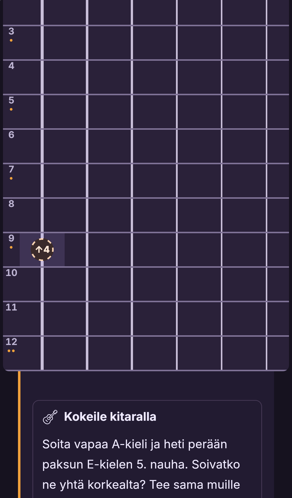 | 01: väärä E 9 → ”↑4” ruudussa, laudan alaosa |
| 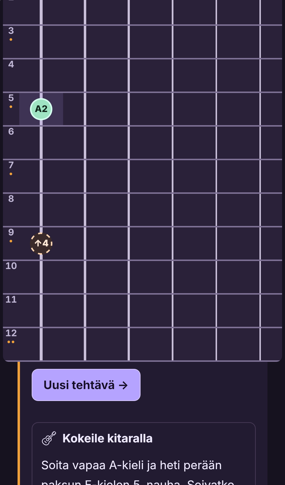 | 01: oikein, Uusi tehtävä laudan alla |
| 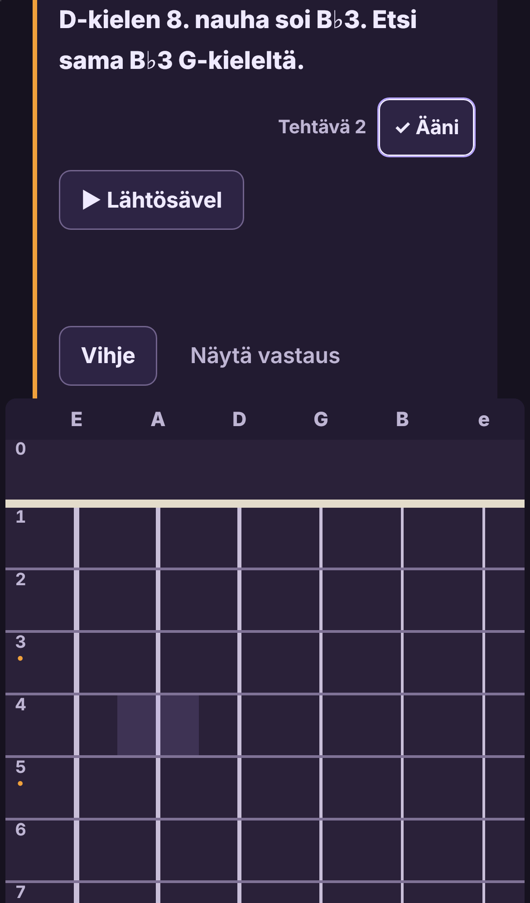 | 01: uusi tehtävä näkyviin laudan alta painettuna |
| 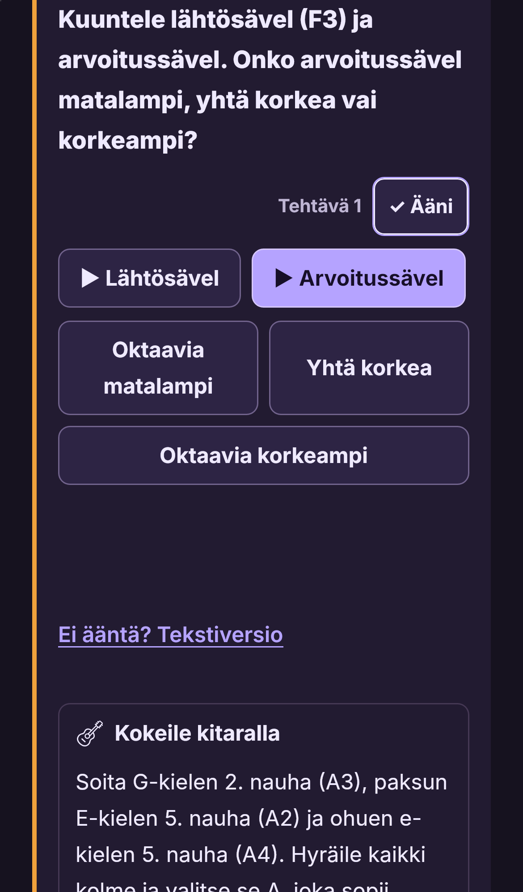 | 02: vaihe A ilman lautaa |
| 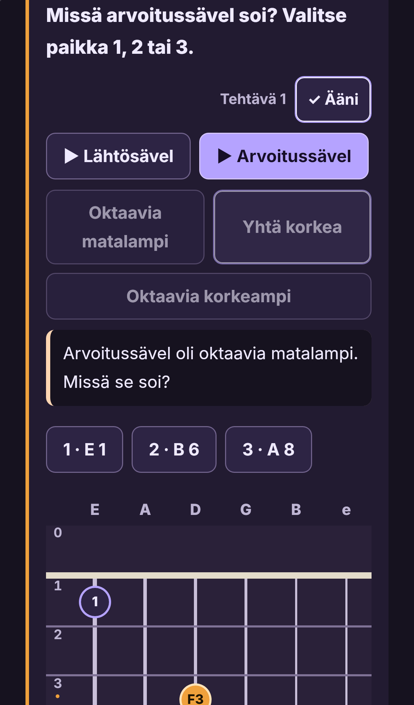 | 02: suhteen palaute painikkeiden alla, sitten paikat ja lauta |
| 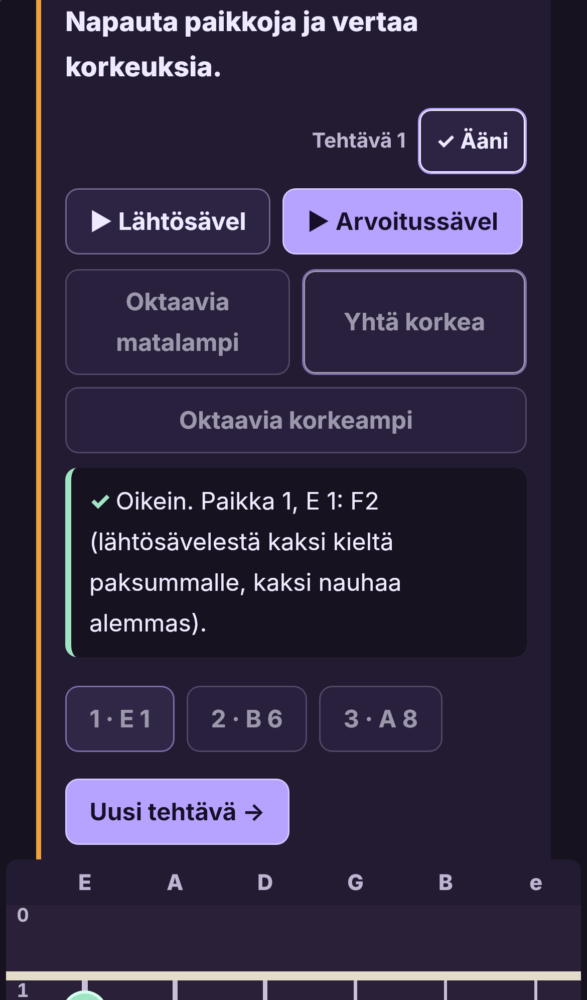 | 02: paikan palaute |
| 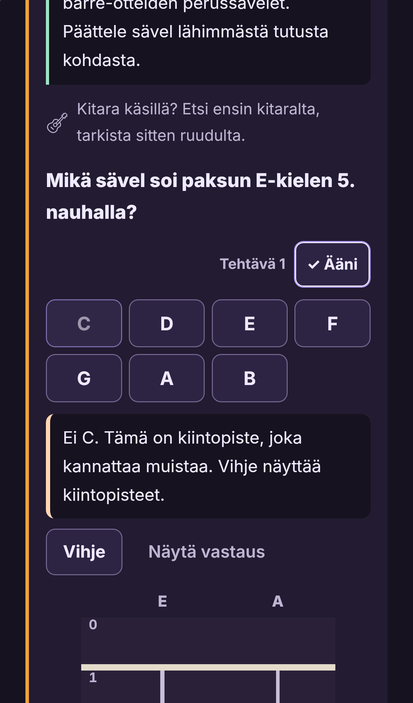 | 03: kiintopiste, virhe |
| 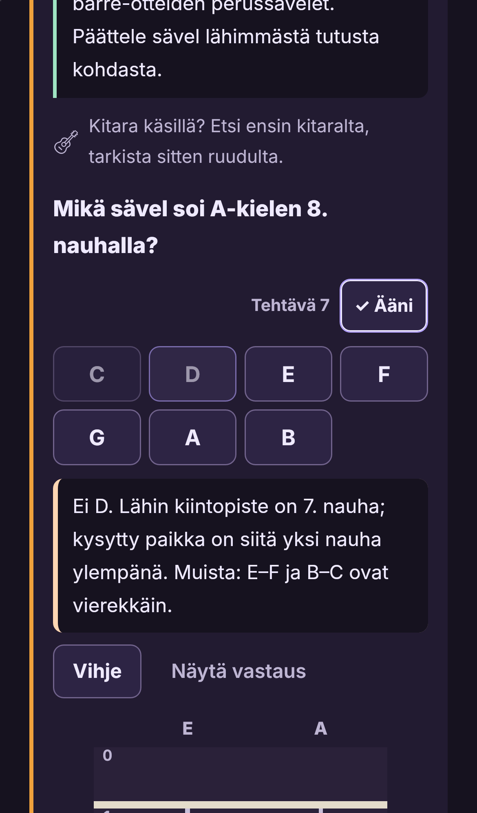 | 03: muu kuin kiintopiste, 2. virhe |
| 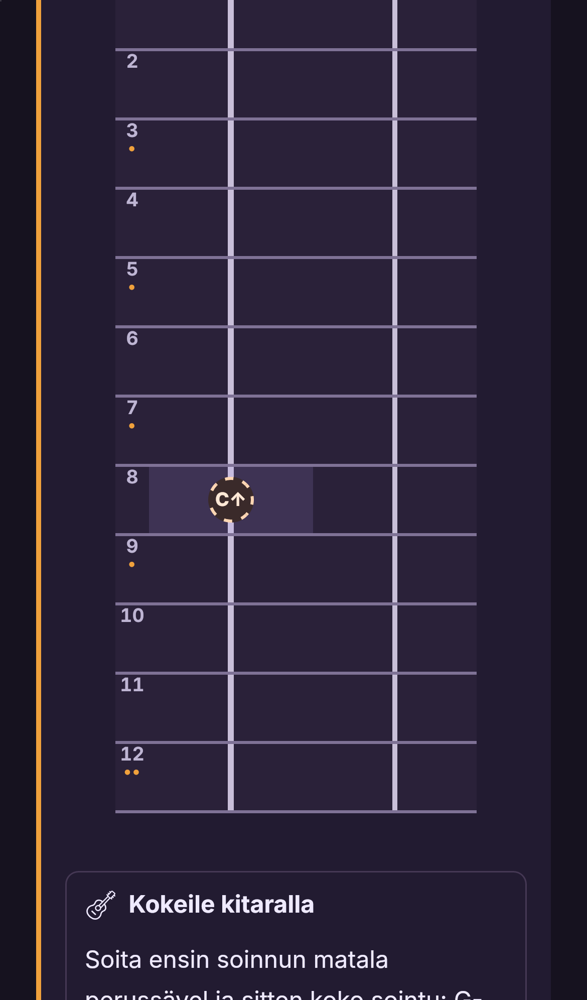 | 03 etsi: väärä paikka, suunta ruudussa |
| 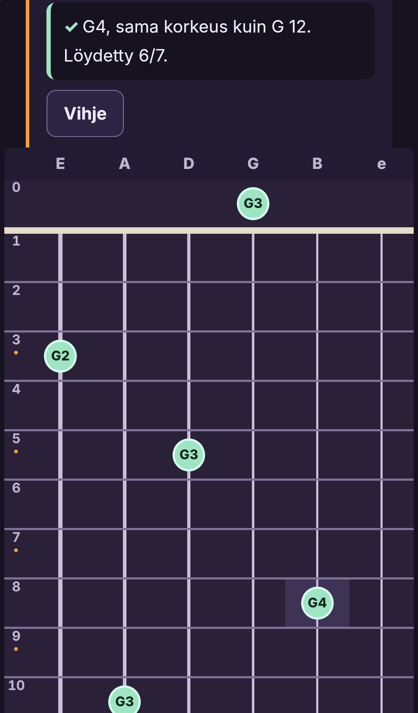 | 04: useita löytöjä, määrä näkyvissä |
| 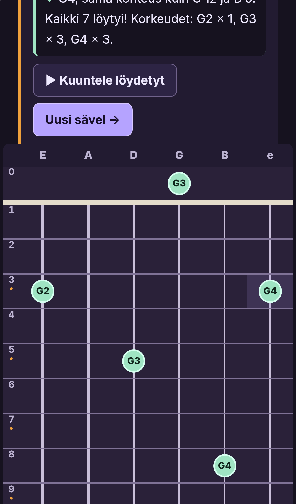 | 04: valmis |
| 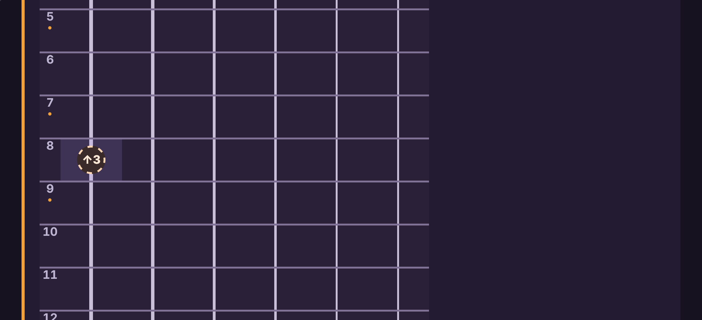 | Vaaka-asento, 01 väärä yritys |

## 6. Avoimet

- **Xcode iOS Simulator** (iPhone 16 Pro ensisijainen, iPhone 17e; pysty ja vaaka): kaikki kohdan 5 tilanteet, erityisesti N1, N2, löydös 6 ja ruudun pysyminen paikallaan Safarissa oikealla kosketuksella. **Ei testattu.**
- Fyysinen iPhone (matalien sävelten kuuntelu, äänen käynnistys), VoiceOver (ruudun ”↑2”-merkin saavutettava nimi, tilaviestit) ja oikean kitaran käyttäjäkoe.

## 7. Hyväksyntäsuositus

**GO KORJAUKSIN → valmis Xcode-uusintatestiin.** N1, N2, N3 ja löydökset 4, 5, 6, 7, 9, 10 on korjattu ja katettu automaattitesteillä Chromiumissa ja WebKitissä. Ennen hyväksyntää: Xcode-simulaattorikoe Macilla, omistajan katselmointi ja commit. Ei yhdistämislupaa.

## TEHTÄVÄN LUOVUTUS PÄÄKESKUSTELUUN

- **Tila:** OSITTAIN VALMIS – toteutus ja automaattitestit valmiit; Xcode-simulaattorikoe tekemättä (pilviympäristö).
- **Lähtö:** `db1f113` (`e3ece3b` + auditointiaineisto); beta `9526b70` ei koske Otelautaa.
- **Haara / commit:** ei committia – muutokset työpuussa katselmoitavaksi (`claude/116-otelauta-auditointikorjaukset`).
- **Testit:** ks. §4.
- **Avoimet:** ks. §6. Lähtötilan epävakaa `responsive.spec.ts`-testi.
- **Omistajan päätökset:** muutosten hyväksyntä ja commit; Xcode-uusinta; myöhemmin yhdistämisjärjestys PR #178:n kanssa.
- **Seuraava rajattu tehtävä:** Macilla Xcode-uusintatesti tällä työpuun tilalla (commitin jälkeen), kirjaus `kierros2/xcode/`.
- **Älä koske:** PR #179:n alkuperäinen haara, PR #178, beta, main, äänet.
