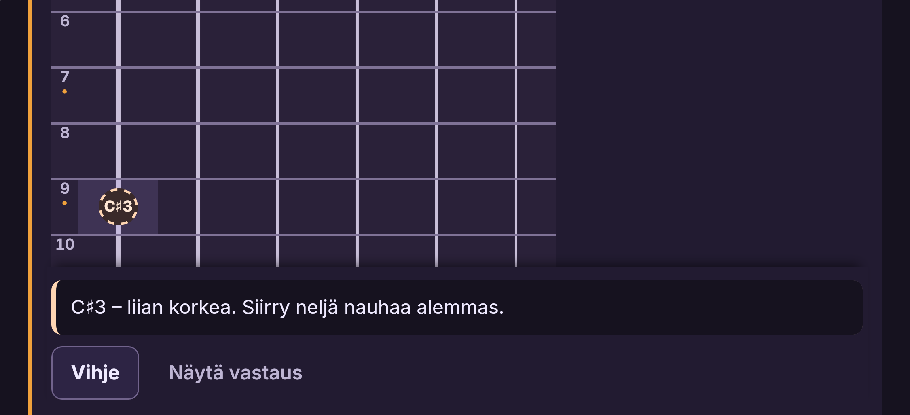
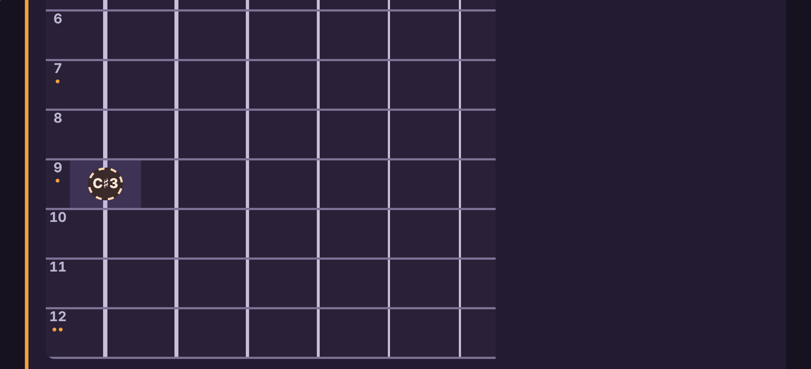
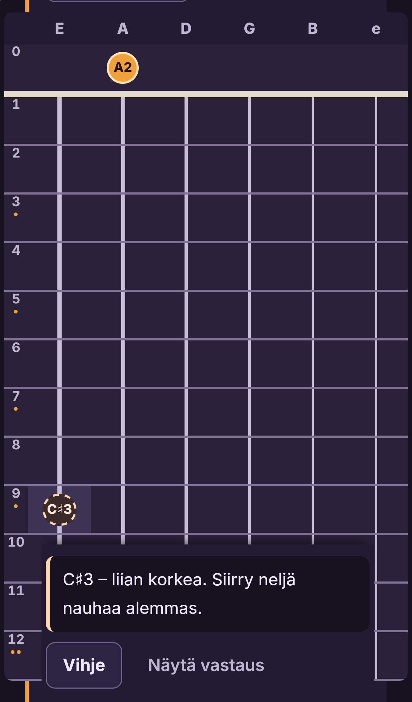
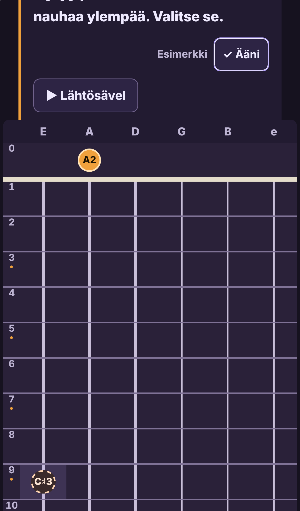
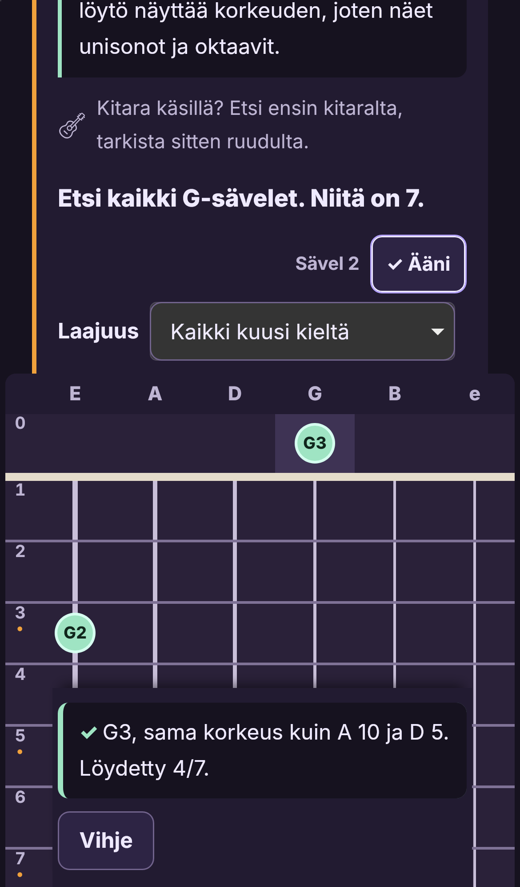
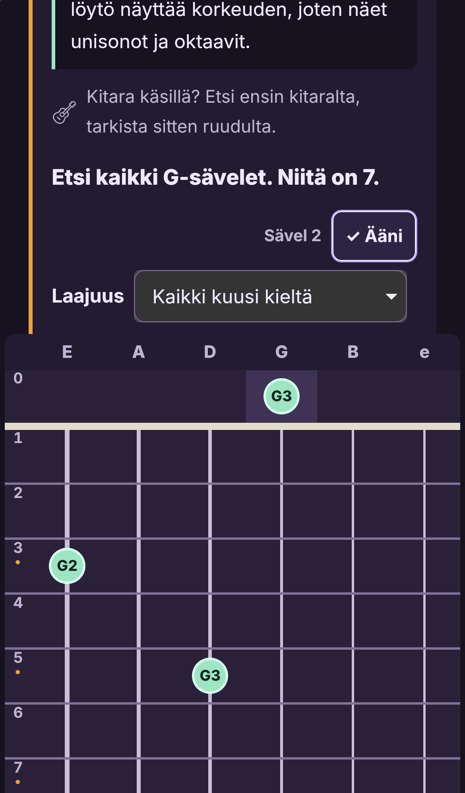
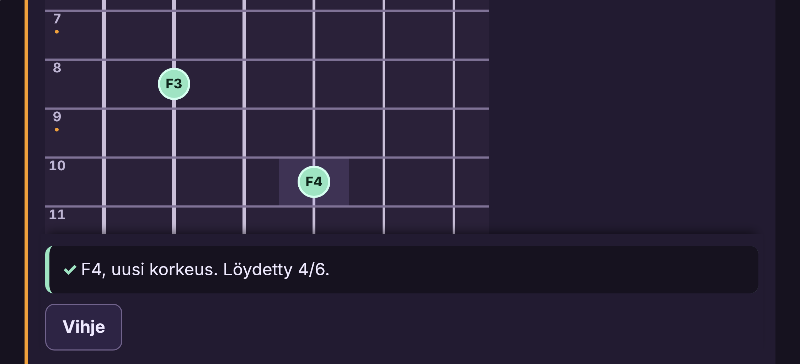
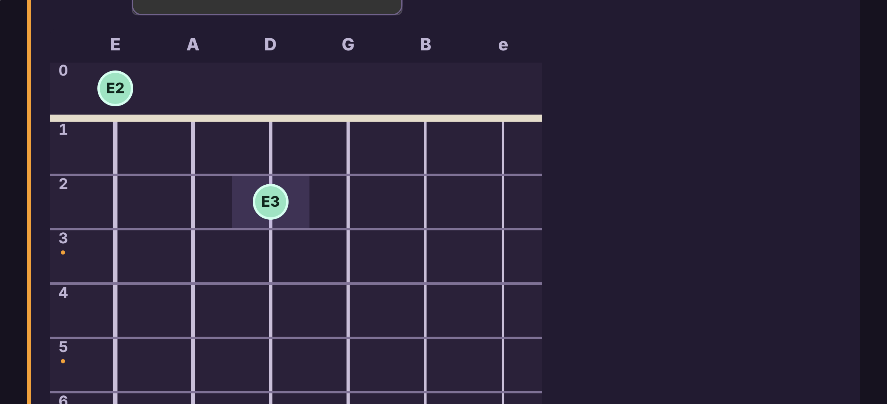

# PR #179 · Otelauta: auditointilöydösten korjausraportti

**24.11.2026 · haara `claude/116-otelauta-ydinopinnot`, pohja `97a49fe` · muutokset committaamatta omistajan katselmointia varten · ei yhdistetty.**

Lähtökohta: auditoinnin johtopäätös **GO KORJAUKSIN**. Tämä raportti kuuluu alkuperäisen auditointiraportin rinnalle eikä korvaa sitä.

> **Alkuperäinen auditointiraportti ja sen iOS Simulator -kuvakaappaukset puuttuvat tästä hakemistosta.** Auditointi tehtiin Macilla eri sessiossa; tämä korjaus tehtiin pilvessä (Linux), jossa niihin ei ollut pääsyä. Kopioi ne tähän hakemistoon sellaisinaan (esim. `auditointiraportti.md` ja `kuvat/`) ennen committia. Korjaukset perustuvat toimeksiannossa kuvattuihin löydöksiin.

## 1. Toteutetut korjaukset

### MAJOR · Palautepaneeli peitti otelaudan

| Vaihtoehto | Arvio |
|---|---|
| A. Normaalisti vierivä paneeli laudan alla | Ei peitä mitään. Pitkä teksti voi jäädä näkymän alle ylimpiä nauhoja napautettaessa. |
| B. Kompakti palaute | Napautettu ruutu näyttää korkeuden ja tilan (oikein / kokeiltu / löydetty). Toimii siellä, missä sormi on. |
| C. Laudan yläpuolelle varattu tila | Ei peitä, mutta jää näkymän ulkopuolelle alempia nauhoja napautettaessa ja vie pystytilaa. |

**Valittu: A + B, sama pysty- ja vaaka-asennossa.** Paneeli vierii sivun mukana laudan alla; välitön palaute näkyy napautetussa ruudussa kaikissa harjoituksissa (04:n väärät yritykset merkitään nyt ruutuun). Ei automaattista vieritystä. Kaikki kuusi kieltä ja ≥ 44 × 44 CSS px:n ruudut säilyvät.

### 03 · Kiintopisteiden osuus ja virhepalaute

- Vanha jakauma: nimeä-tehtävistä **57 %** (4/7) kiintopisteissä koko ajan.
- Uusi: tehtävät 1–4 tavoite 75 % (mitattu 78 %), tehtävästä 5 alkaen 20 % (mitattu 20 %); 20 tehtävän jakso 31 %. Kiintopisteitä kysytään edelleen myös myöhemmin.
- Väärä nimi ei enää paljasta lähimmän kiintopisteen sävelnimeä: 1. virhe ”Ei B. Lähde lähimmästä kiintopisteestä ja laske nauhat siitä.”, 2. virhe ”Ei B. Laske 7. nauhasta. Muista: E–F ja B–C ovat vierekkäin.” Oikea vastaus selittää päättelyn edelleen (”Löydät sen B:n vierestä”).
- Perustelu: [docs/oppiminen/otelauta-ydinopinnot-116-2026-11-23.md §3.4](../../docs/oppiminen/otelauta-ydinopinnot-116-2026-11-23.md).

### Dokumentaatio · PR #178 ja `rakenna.py`

Aiempi väite oli virheellinen: PR #178 (HEAD `b6ff787`) muuttaa `rakenna.py`-tiedostoa. Koeyhdistäminen väliaikaisessa työpuussa (ei pushattu, poistettu):

| Tiedosto | Tulos | Ratkaisuperiaate |
|---|---|---|
| `tools/oppimiskartta/rakenna.py` | Konflikti | Säilytä **molemmat** latauslohkot (`otelauta-ydinopinnot.*` ja `melodia-ydinopinnot.*`) |
| `tests/oppimiskartta-kokonaisuudet.test.ts`, `tests/e2e/aihesivut.spec.ts`, `aihelista.spec.ts`, `lukumerkinnat.spec.ts` | Konflikti | aiheet.json-pohjainen `progress_text`-tunnistus (kattaa molemmat aiheet) |
| `tools/oppimiskartta/aiheet.json`, `index.html` | Automaattinen | Regeneroi `npm run build:oppimiskartta` ja tarkista `--tarkista` |

Pedagoginen dokumentti §6 on korjattu. **PR #179:n kuvaus päivitetään vasta omistajan katselmoinnin jälkeen** samassa yhteydessä kuin commit (tämä raportti sisältää korjatun tekstin).

### Äänet

Ei muutoksia demoääniin, voimakkuuteen, yläsävelrakenteeseen tai yhteiseen äänimoottoriin. Matalien sävelten kuuntelu fyysisellä iPhonella on **avoin omistajan testi**.

## 2. Ennen–jälkeen-kuvakaappaukset

**Huom.:** alla olevat kuvat ovat Playwright WebKit -emulaatiosta (iPhone 13 -profiili), eivät Xcode iOS Simulatorista. Ne täydentävät, eivät korvaa simulaattorinäyttöä. Ennen = `97a49fe`, jälkeen = tämä työpuu.

| Tilanne | Ennen | Jälkeen |
|---|---|---|
| 01 väärä yritys, vaaka |  paneeli peittää nauhat 10–12 |  koko lauta näkyy |
| 01 väärä yritys, pysty |  |  |
| 04 löydöt, pysty |  |  |
| 04 löydöt, vaaka |  |  |

## 3. Muutetut tiedostot (committaamatta)

- `assets/otelauta-ydinopinnot.js` – paneeli ei tahmea; 04:n väärä yritys merkitään ruutuun; 03:n jakauma (`LANDMARK_PHASE`, `landmarkShare`, `isLandmarkRound`) ja virhepalaute (`checkRootName(…, attempt)`).
- `assets/otelauta-ydinopinnot.css` – tahmea paneeli poistettu.
- `assets/otelauta-ydinopinnot.d.ts` – uudet tyypit.
- `tests/otelauta-ydinopinnot.test.ts` – jakauma- ja virhepalautetestit.
- `tests/e2e/otelauta-ydinopinnot.spec.ts` – peittymisen regressiotesti, leveydet 320/375/390/402/430, 03:n uusi palaute, asettumisen odotus.
- `docs/oppiminen/otelauta-ydinopinnot-116-2026-11-23.md` – §3.2, §3.4, §4b, §6.
- `oppi/otelauta/*.html` – generoitu (tyylitiedoston versio).
- `auditoinnit/pr179-otelauta-2026-11-24/` – tämä raportti ja korjauskuvat (seuraamattomia, eivät katoa siivouksessa ennen committia; älä aja `git clean`).

Ei muutoksia vanhojen sisältöjen URL-osoitteisiin, ankkureihin tai suoritusmerkintöihin, yhteiseen äänimoottoriin, `rakenna.py`:hyn tai `aiheet.json`:iin.

## 4. Testitulokset

| Komento | Tulos |
|---|---|
| `npm run check` (lint, typecheck, Vitest, build) | OK, **721/721** |
| `rakenna.py --tarkista`, `tarkista-linkit.py` | OK; 121 sivua, 2 988 viittausta, 0 ongelmaa |
| Otelauta-spec Chromium (desktop + phone) | **48/48** |
| Uusi peittymistesti vanhalla tahmealla paneelilla (negatiivinen kontrolli) | **epäonnistuu** odotetusti (”paneeli leikkaa otelautaa”) |
| WebKit paikallisesti (Safari-työpöytä + iPhone 13 -emulaatio; Otelauta + yhteinen vieritys) | **60/60**; leveystestit `--repeat-each=4` 40/40 |
| Koko Playwright Chromium | **1 136 läpi, 49 ohitettu, 1 epäonnistui**: `responsive.spec.ts` ”pehmeä vieritys … positio 1”, sama lähtötilan epävakaa testi kuin betassa |

Automaattisesti katettu: 320/375/390/402/430 px, vaaka 844 × 390, 200 % tekstikoko (360 px), 400 %:n reflow (320 px), kosketuskohteet ≥ 44 × 44, ei vaakavieritystä, näppäimistö, peittymättömyys `elementFromPoint`-menetelmällä kaikille laudan ruuduille, merkinnöille, kuuntelu- ja toimintopainikkeille, laajuusvalinnalle ja fokukselle.

**Xcode iOS Simulator (iPhone 16 Pro, iPhone 17e, pysty/vaaka): ei tehty.** Tämä sessio toimii pilvessä Linuxissa ilman pääsyä Maciin; simulaattoritestausta ei korvattu emulaatiolla.

## 5. Korjatut auditointilöydökset

- MAJOR: palautepaneeli peitti valitun paikan, lähtösävelen, löydöt, kosketuskohteita ja fokusta → korjattu, regressiotesti lisätty.
- 03: kiintopisteosuus 57 % koko ajan → vaiheistettu 75 % → 20 %.
- 03: virhepalaute paljasti vastauksen lähes suoraan → vaiheittainen menetelmäpalaute.
- Dokumentaatio: virheellinen väite PR #178:n `rakenna.py`-muutoksista → korjattu, konfliktit dokumentoitu.

## 6. Uudet havainnot

- WebKit-iPhone-emulaatiossa 320 px:n leveystesti mittasi laudan ennen ResizeObserverin levitystä (1 satunnainen epäonnistuminen). Testi odottaa nyt asettumista. Oikealla laitteella mahdollinen hetkellinen ennen-levitystä-näkymä on tarkistettava simulaattorissa.
- Beta on liikkunut (`9526b70`, kappaleharjoittelijan D2-soitin). Ei koske Otelaudan tiedostoja; haaraa ei päivitetty tässä työssä.

## 7. Avoimet testit

- **Xcode iOS Simulator:** iPhone 16 Pro ja iPhone 17e, Safari, pysty ja vaaka; erityisesti aiemmin peittyneet tilanteet.
- **Fyysinen iPhone:** matalien sävelten (E2–A2) kuuluvuus kaiuttimesta ja kuulokkeista; äänen käynnistys ja pysäytys.
- **VoiceOver:** ruudukon navigointi, paikkojen nimet, tilaviestit, 04:n laajuusvalinta.
- **Oikea kitara:** QA-raportin kitarakoe (`docs/qa/otelauta-ydinopinnot/raportti.md`).

## 8. Päivitetty hyväksyntäsuositus

**GO KORJAUKSIN → ehdollinen GO katselmointiin.** Auditoinnin MAJOR-löydös ja 03:n pedagogiset huomiot on korjattu ja katettu automaattitesteillä Chromiumissa ja WebKitissä. Ennen beta-yhdistämistä: (1) omistajan katselmointi ja commit, (2) Xcode Simulator -uusinta iPhone 16 Pro / 17e pysty ja vaaka, (3) fyysisen iPhonen kuuntelukoe, (4) PR #178:n yhdistämisjärjestys ja konfliktien ratkaisu yllä kuvatulla periaatteella.
