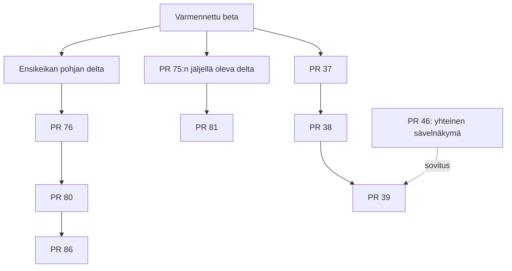

# Musiikin kartan projektiauditointi 16.11.2026

[Päätehtävälista #54](https://github.com/ristotoivanen/Musiikin-kartta/issues/54) · [Haarat ja PR:t](inventaario.md) · [Keskustelut ja arkistointi](keskustelut.md) · [Päätehtävälistan katselmoitu päivitys](tehtavalista-54.md)

## Ajantasainen tarkistuspiste 16.11.2026 – vaihe 1/6

**Tämä on myöhempi tarkistus kuin alla oleva alkuperäinen auditointilukitus `beta f7a204b`.** Vanhemman tarkistuspisteen 581/581-testit ja sen haarataulukot säilyvät historiallisena näyttönä; niitä ei saa automaattisesti lukea uusimman betan testituloksiksi.

| Kohde | Tarkistettu tila |
| --- | --- |
| GitHub `main` | `68b8a772ac228371744e32b7fbc84c500b073687` |
| GitHub `beta` | `f9964c5463411a99f961fa9f6eed3fd3d72e6aba` |
| GitHubin `main...beta` | 2 vain `main`-haarassa, 81 vain `beta`-haarassa; erkaantunut historia |
| GitHubin avoimet PR:t / issuet | 29 / 28; haarahaun palauttamat 60 GitHub-haaraa |
| [PR #83](https://github.com/ristotoivanen/Musiikin-kartta/pull/83) | Yhdistetty `beta`-haaraan 16.11.2026; lähdehaaran kärki `fdeb26ecbbafdde3424c4c3c91d0da980234972d` |
| [Betan Actions-ajo](https://github.com/ristotoivanen/Musiikin-kartta/actions/runs/43937905928) | Onnistui `f9964c5`-tarkistuspisteessä: npm-riippuvuudet, lint, yksikkötestit, build ja työnkulkuun rajatut Chromium/Playwright-testit; ei koko E2E-matriisi eikä fyysisiä laitekokeita |

**PR-riippuvuuksien todettu nykytila:** #57–#61, #64 ja #65 ovat edelleen avoimia luonnoksia, vaikka niiden kärki-commitit ovat uusimman `beta`-historian esi-isiä. Tämä **ei** yksin osoita kyseisten PR:ien kaikkien katselmointi- tai toiminnallisten hyväksyntäehtojen täyttyneen. #62 ja #63 erkanevat `beta`-haarasta ja vaativat nykybeta-deltan sekä vaihtoehtoisten toteutusten vertailun. Aktiiviset pinot #76 → #80 → #86 (Ensikeikka), #64 → #75 → #81 (Riffikaiku) ja #37 → #38 → #39 (mobiili/harjoitukset) säilytetään erillään.

**Omistajan Macista lukevasti vahvistettu:** `git ls-remote` vastasi yllä olevia GitHubin ref-tunnisteita. Paikallinen päätyöpuu on `main b04a50f` (351 commitia paikallista `origin/main`-viitettä jäljessä), `origin/main 68b8a77` ja `origin/beta f7a204b` (vanha viite). Päätyöpuun seuratut tiedostot olivat muuttumattomia, mutta seuraamattomina on `.DS_Store`, `test-results/.last-run.json` ja `transkriptiot/yksi-sointu-kaksi-askelta.md`. Viimeksi mainitun 28 kt:n hakemiston sisältöä eikä riippumatonta talteenottoa ole vahvistettu; säilytettävä. Runsaat erilliset worktreet, myös `/private/tmp`-polussa oleva detached HEAD, ovat olemassa. Niiden puhtautta tai sivuutettuja tiedostoja ei ole systemaattisesti varmennettu.

**Tämän tarkistuspisteen rajaus:** Ei git pull/fetch/reset -toimintoja omistajan Macissa, ei PR-mergejä tai sulkemisia, ei haaran/worktreen poistoja. Seuraava vaihe on erillinen PR-kohtainen todellisen sisältödeltan ja riippuvuuksien katselmointi; vanhan snapshotin taulukoita ei saa tulkita nyt vallitsevaksi PR-tilaksi.

## Tilanne ja näyttö

- **Tuotannon Git-pohja:** `main` `68b8a772ac228371744e32b7fbc84c500b073687`, yhdistetty julkaisu-PR [#42](https://github.com/ristotoivanen/Musiikin-kartta/pull/42) 14.11. Kitaraharjoittelija, Otelautaopas, teoria, aiempi navigaatio ja Riffikaiku/Ensikeikka-perusversiot ovat tässä julkaisupohjassa. Cloudflare-check on onnistunut.
- **Beta:** `f7a204bf8b4268e794c8afc7130cc799384f6946`. Jäädytetty integraatiohaara osoittaa samaan commitiin. Betassa on kahdeksan Oppimiskartan aihetta, erilliset sisältösivut ja viisi Kitaran perusteiden harjoitussivua, Riffikaiun kaksi käyttötapaa ja muistiotto sekä Ensikeikan kaksi iltaa ja kappaleet 1–9. [Integraatiomuistio](../CLAUDE_INTEGRAATIO_JATKO.md) kuvaa tarkat lähde-SHA:t ja tehdyt reitityssovitukset.
- `main...beta` on **2/72 commitia**. Mainin kaksi yksinomaista committia ovat julkaisut #36 ja #42. Lukumäärä sisältää eri historian ja puolen; sisällöllinen tuotantoero arvioidaan julkaisu-PR:ssä.
- Auditoinnissa ajettiin betan puhtaasta tarkistuspisteestä `npm run check`: lint, typecheck, build ja **581/581 yksikkötestiä** läpi (35 testitiedostoa). [GitHub Actions](https://github.com/ristotoivanen/Musiikin-kartta/actions/runs/43755261098) ja Cloudflare-check onnistuneet juuri tällä beta-SHA:lla. Actions ajaa rajatut asteikko- ja peliregressiot Chromiumilla. Aikaisemmat [f401413](https://github.com/ristotoivanen/Musiikin-kartta/actions/runs/43754688230) ja [78586e9](https://github.com/ristotoivanen/Musiikin-kartta/actions/runs/43753501556) epäonnistuivat. Integraatiomuistio dokumentoi kosketustestin ja yksikkötestin aikarajan korjaukset. Tässä auditoinnissa ei ajettu koko Playwright-matriisia eikä fyysisiä laitekokeita.
- Tarkistuspisteen inventaario kattaa **59 haaraa**, **59 PR:ää (29 auki, 30 yhdistetty)** ja **28 varsinaista issuea (27 auki, #8 suljettu)**. #8:n sulkeminen on aiemman ääniaineiston laadunvarmistus, eikä kuittaa #9:n Safari-kokeita tai #87:n äänilinjaa.

## Päätökset, toteutus ja puutteet

Alla **päätös** tarkoittaa käyttäjän rajaus- tai dokumentointipäätöstä. **Palaute** kuvaa käyttäjän havaintoa. **Ehdotus** merkitsee suunnitelmaa tai auditoinnin jatkovaihtoehtoa. Keskustelujen yksilöinti ja kattavuus ovat [keskusteluluettelossa](keskustelut.md).

| Kokonaisuus | Viimeisin päätös tai havainto | Keskustelulähde | GitHub ja toteutustila | Puute ja toimenpide |
| --- | --- | --- | --- | --- |
| Oppimiskartta, navigaatio, teoria | Päätös: aiheille ja sisällöille omat sivut, selkeä paluu, H-sävelen selitys tekstissä lähdeviitteellä. Numerointi oli käyttäjän avoin kysymys. | Ensikeikan jatkokehitys suunnittelu, Musiikin kartan rakenne, 15.11. | #55 yhdistetty; #57–#61 ja `codex/oppimiskartta-aihesivut` sisältyvät nykybetan historiaan. #62 ja #63 ovat rinnakkaiset prototyypit. | Varmista selaimen takaisinlinkit ja fokus, vanhat reitit, H-otsikot sekä esitysero nykybetaan. #62 ja #63 muuttavat samoista tiedostoista 43:a oman pohjansa suhteen. Valitse vain todennettu puuttuva parannus. |
| Kitaran perusteet | Päätös: 2–5 minuutin pikakertaus, kolme sisältöryhmää, suora Oppimiskartta-linkki ja vanhojen harjoitusten osoitteiden/tallennusten säilytys. Käyttäjä pyysi grafiikoiden korjausohjeen. | Kitaran perusteiden suunnitelma, 16.11. | #72, dokumentti #74, koodi #83 `3afff74` suoraan betalta. #65 `49865f8` jo betassa ja edustaa aiempaa laajempaa ratkaisua. | #83:n [uusin esikatselu](https://152a4afb.musiikin-kartta.pages.dev/oppi/kitara/) sisältää otelaudan, viisi sointukaaviota, tabin ja 4/4-kuvan. PR raportoi 581 yksikkötestiä ja rajatut selainajot 178/178 sekä 12/12. Kertauksen omistajakatselmointi, fyysinen puhelin ja ruudunlukija avoinna. |
| Kitaraharjoittelija ja Otelautaopas | Päätös: nykyinen navigaatio ensin, auditoinnin jälkeen jatkokorjaukset; pidempi kokonainen melodia muistivaiheeseen, tabi oletuksena kiinni ja improvisointi erillisenä. | Suunnittele yhtenäinen navigaatio Claude, Kitaraharjoittelija kaalat ja moodit, Sävelkorva ja otelauta · vaihe 1. | #25/#27/#28/#33 yhdistetty, #58 betassa historian kautta. #37–#39 ja #46 auki; #44 ja #43 seuraavat rajattuja korjauksia. | Tarkista #44:n hyväksyntä nykybetasta. #37:n testit fyysisellä iPhonella, sitten #38:n melodioiden soitettavuus ja #39:n kuuntelukoe. #46 ja #39 koskettavat samaa `NoteJourney.tsx`:ää. |
| Riffikaiku | Palaute: oletus paljastaa vastauksen liian helposti. Hyväksytty suunta: kuuntele ja etsi ennen vihjeitä; ensimmäinen kaksisävelinen harjoitus voi olla ohjattu. Oikean kitaran harjoittelu ja virtuaalipeli ovat erilliset käyttötavat. | Riffikaiku suunnittelu. Claude koodaa, 16.11. | #64 on betassa; #75:stä jäädytetty `d84b616` betassa ja viimeistely `ec50a94` ulkona. #81 `625b982` jatkaa #75:tä. #51 ja #56. | Katselmoi #75:n viimeinen delta ennen #81:tä. Testaa oletus, vapaa harjoittelu, arvioitava otto, apu, peruutus, oikea kitara/mikrofoni, paluu oppimisaiheeseen ja tallennus. Ketju säilyttää betan integraatioreitit. |
| Bänditreenit ja Ensikeikka | Päätös: 1–9 ovat Bänditreenit; varsinainen ensimmäinen keikka 10–12 oma valinta ja näkymä. Lopetusten A/B/C vaihtuu normaalissa etenemisessä. Keikkakalenteri on myöhempi suunnitelma. Käyttäjä haluaa musiikillisesti uskottavat harjoitukset ja vaihtelevat oppimistavat. | Ensikeikka Kehityksen ja vaikeusasteen suunnittelu, Ensikeikan kehitystyö, 15.–16.11. | #79/#86, #78/#80, #76. Jäädytetty `6dfa967` betassa, #76:n vanha pohja `6fca456` kaksi commitia sitä edellä. #47:n #59 mukana nykyisessä betassa. | Katselmoi ensin `6dfa967..6fca456` (onnistumis-/jatkokortti ja käännös), sitten #76 → #80 → #86. Säilytä linkit, tunnisteet ja nykyiset tallenteet. Kappaleiden 6–8 kuulonvarainen hyväksyntä ja 7/9 basso puhelimessa avoinna; 10–12 mukaan esikatselukokeeseen. |
| Rytmi ja komppi | Päätös: dokumentoi pulssi, vaimennettu soitto, tauot, aksentit, synkoopit ja saman kierron eri kompit. Hyväksytty dokumentoitavaksi myös OSS-kokeen ideat. | Rytmiosion uudistus, Bluesasteikon puuttuminen, Fable käyttökohde projektille, 15.–16.11. | Betassa nykyinen pulssi-/komppisisältö. Tarkempi ohjelma #69, suunnitelmat #70/#77, OSS-auditointi #82/#85 ja työkaluriippuvuus #84. | Yksi rajattu kuuntelu–ruudukko–oikea kitara -pilotti vasta G1-rajauspäätöksen jälkeen. Mikrofonimittaus ja näytevertailu ovat ehdotuksia. Sovita neljän iskun A/E-pilottiin ja vältä rinnakkaiset tehtävälistat. |
| Sointujen maailma, asteikot ja moodit | Päätös: tallenna ja vaiheista teoria, pelit ja harjoitukset; mollibluesasteikko tehtävälistalle. CAGEDin kahdeksan lukua ja peli-ideat ovat suunnitelma. Käyttäjän ”Toimii” koskee aiempaa sointukarttakokeilua. | Musiikin oppimispolku, Bluesasteikon puuttuminen, Sointukartan tarkistus, Oppimispolun suunnittelu. | #67/#48, #68, #52, #30/#39, #31/#38, #5. Asteikkoja ja moodipolut jo julkaistu; mollibluesin yhteinen toteutus suunniteltu. | Tee yksi rajattu musiikillisesti validoitu sointu- tai asteikkotehtävä kerrallaan. Seitsemän-/nelisävelsointujen aiempi käyttötesti ei kata CAGED-polun hyväksyntää. |
| Äänet, Suno ja kappaleet | Palaute ja linjaus: nykyinen soundi liian MIDI-mäinen. Perusharjoitukset toistettavilla soitinnäytteillä ja tarkalla ajoituksella, Suno ehdokas alkuperäisiin kokonaisiin kappaleisiin ja taustoihin. Speech/Sounds on selvitysidea. | Fable käyttökohde projektille, Rytmiosion uudistus, Harjoitusbiisin suunnittelu, Vaihtoehtojen vertailu. | #87/#69/#9; #8 suljettu. A-mollisovitus ja lähderaidat ovat tuotantoaineistoa erillään sovelluksen hyväksynnästä. | Vertaile näytteitä, mittaa soiton ajoitus, varmista tasot, stemien keskinäinen kohdistus, käyttöoikeus ja aidon kompin artikulaatio. Äänimoottori, aineistolähteet ja julkaisukelpoiset kappaleversiot ovat avoimia. |
| Mobiili ja Safari | Palaute: iPhonella ajoittaista stemmien puuttumista, kuuntelutehtävässä halutaan sarja → tauko → kysytty sävel. | Suunnittele yhtenäinen navigaatio Claude; Sävelkorva ja otelauta · vaihe 1; Riffikaiku-keskustelu. | #35:n GainNode-korjaus ja #33 yhdistetty. #39:n `513e7d7` sisältää pyydetyn kysymysjärjestyksen; #9 ja #37–#39 auki. | Toista iPhonella kappalooppi, kelaus, keskeytys, virransäästö/taustalta paluu, stemmat, äänen katkaisu ja fyysinen mikrofoni; kirjaa laite, iOS, commit ja toistotulos #9:ään. |
| Työkalut ja laajennukset | Päätös: dokumentoi aiheet, viimeistele nykyinen uudistus ennen laajennusta. Keskeneräiset tai tyhjät aiheet jäävät pois näkyvistä. | Musiikkikartan puuttuvat aiheet, Fable käyttökohde projektille, Harjoitusideoiden tulkinta. | #71/#73 ja #84. #49/#50/#52 mahdollistavat myöhemmät jaksot/pelit. | #84:n metronomi ja viritin erillisinä sekä upotettuina, yksi yhteinen käytäntö äänen keskeytyksille. Ulkopuolinen palaute ja Steminize on kirjattu alla arvioitaviksi. |

## Talteenotto ja avoimet tulkinnat

- **Uutta tässä auditoinnissa:** toteutuksen tarkat jäädytysrajat ja PR:n avoimen tilan ero commitin sisältymiseen, #62/#63:n rinnakkaisuus, #83:n uusimman grafiikkaversion katselmointiehdot, keskustelujen lähdekartta, #76:n oman pohjan delta sekä otsikkokorjausta koskeva ristiriita.
- **Riffikaiku-keskustelun reittipalaute:** etsi kaikki C-sävelet -kohdalle pyydettiin oma linkki. Tarkista ensin, löytyykö suora osoite jo nykybetasta ja mihin paluu vie. Sido mahdollinen puute olemassa olevaan #56:een tai #50:een tavoitteen mukaan, ilman uutta päällekkäistä issuea.
- **Steminize ja vertailtavat työkalut:** käyttäjä pyysi selvitystä soveltuvuudesta nykyiseen tunnistukseen. Rajaa offline-stem-erottelu, reaaliaikainen yksittäisen sävelen arviointi ja valmis harjoitusaudio omiksi arvioiksi. #87:n yhteydessä voidaan päättää offline-aineistopolusta. Aineiston käyttöoikeudet ja lisenssit tarkistetaan, ja integraatiotarve on avoin.
- **Ulkopuolinen käyttäjäpalaute:** viritys, sointujen tunnistus ja rakentaminen, selittävä palaute ja oppimisen ajatuskartta ovat ulkopuolisia ehdotuksia. Kiinnityskohdat #84, #48, #49 ja #71. Nämä tarvitsevat omistajan priorisoinnin. Ääniviestien täydellistä sisältöä ei varmennettu.
- **Vanhentuneet kuvaukset:** #54:n historiallinen #55/#61-tilanne, #65:n viisisivuinen aloitusmalli, #61:n varhaisen Ensikeikan linkkiteksti sekä #79:n otsikon ja #86:ssa kuvatun toteutuksen välinen epäselvyys. Varmista #79:n hyväksynnässä, että 1–9, treenikerrat ja 10–12 kuvataan todellisen näkymän mukaisesti.
- **Avoimet päätökset:** kumpi #62/#63:eista tarjoaa regressiottoman parannuksen nykybetaan, G1-pilotin sisältö ja A/E-vertailukynnys, Riffikaiun todellinen vaikeus oikealla soittimella, kuulo- ja mobiilihyväksynnät, näytteenottimen ja materiaalien valinta. Säilytä vanhojen pelien beta-merkintä käyttäjän julkaisulinjan mukaisesti.

## Oppimiskartan keskustelukoosteen täydennys (16.11.2026)

[Käyttäjän toimittama arkistointiyhteenveto](oppimiskartan-integraatio-arkistointikooste.md) tarkentaa alkuperäistä keskustelua: **01–08-numeroinnin periaate on hyväksytty**, mutta aiheiden täsmällinen pedagoginen etenemisjärjestys ei ole lopullinen. Aiempi auditointirivi `numerointi oli käyttäjän avoin kysymys` kuvaa aikaisempaa keskusteluvaihetta, ei tätä myöhemmin talteen otettua päätöstietoa. Sivujen omat osoitteet, paluureitit, H/B-selitys opetustekstissä sekä vanhojen linkkien ja suoritusten yhteensopivuus säilyvät sovittuina lähtökohtina.

Vahvistamaton toteutusasia on **kumpi rinnakkaisista draft-prototyypeistä #62/#63**, jos kumpikaan, tuottaa vielä nykybetasta puuttuvan parannuksen. #62:n viimeisin HEAD on `3a985d1`, #63:n `f210a74`. #63 kuvaa kanonisista 11 teoriaosasta generoituja 8+28 sivuja; #62 vaatii kanonisen generaattorin ratkaisemista. Kummankaan omia automaattisia testejä ei PR-kuvauksissa ole vahvistettu ajetuiksi. Nykybeta on lisäksi päivittynyt alkuperäisen #61 → #55 → beta -ohjeen jälkeen: #55 on yhdistetty ja #57–#61:n sisältöä on jo betan historiassa. **Älä käsittele historiallista PR-järjestystä enää uutena yhdistämisohjeena.**

Avoimet katselmoinnit, fyysiset testit, G1 ja A/E-kynnys sekä #62/#63:n vertailu ovat nykyisessä [#54:ssä](https://github.com/ristotoivanen/Musiikin-kartta/issues/54) ja tämän auditoinnin P0/P2-jaksossa. Älä luo niistä päällekkäisiä issueita. Arkistointikooste on nyt GitHubissa, mutta keskustelun arkistointi vaatii erillisen käyttäjän päätöksen.

## Riippuvuudet ja yhdistämisjärjestys

1. **P0.** Varmista yhteinen beta, fyysinen iPhone/Safari ja riippuvuudet. Katselmoi jo mukana olevat #57–#61, #64 ja #65 betasta. Sulkemispäätökseen riittävät hyväksytty toiminnallinen näyttö ja linkit sisältyviin committeihin.
2. **Ensimmäinen pieni koodikatselmointi.** #83 on suoraan nykybetan päältä. #74 on erillinen suunnitelma. Omistajan hyväksyntä, mobiili, 200 % teksti, näppäimistö, ruudunlukija, vanhat osoitteet ja kuittaukset. #62/#63:n mahdollinen valittu delta sovitetaan tämän jälkeen tuoreesta betasta. Tarkista yhteiset `index.html`, `assets/edistyminen.js` ja `tests/site.test.ts`.
3. **Erilliset integraatioehdokkaat.** Riffikaiku #75:n jäljellä oleva delta → #81. Bänditreenit/Ensikeikka oma pohjadelta → #76 → #80 → #86. Mobiili #37 → #38 → #39, ja #46 sovitetaan ennen #39:n hyväksyntää. Jos #46:n ääniharjoitus valitaan ensin, siirrä sen keskeytyslogiikka #39:n sovitukseen ja testaa yhdessä. Vältä raakaa koko pinon yhdistämistä vanhalta pohjalta. Katselmoi päällekkäisyydet lähteissä, rakenna generoitu HTML/JS uusiksi ja vertaa lukittuun beta-SHA:han. Ketjujen välinen julkaisu tehdään yksi kerrallaan.
4. **Dokumentaatio.** #34/#40 ovat historiallista testiaineistoa. #53, #66, #67, #70, #73, #74, #77 ja #85 katselmoidaan dokumentteina. Tarkista vanhentuneet suunnitelmarivit ja ristiriidat ennen arkistointia tai yhdistämistä. #66:n ohjelma päivitetään vastaamaan #79/#86:n jaettujen näkymien rajoja. Mainiin kohdistuville #66/#67/#73:lle valitaan dokumenttien oikea kohde erikseen.
5. **Haarojen siivous hyväksynnän jälkeen.** Ensimmäisiä vertailuehdokkaita ovat jo julkaistut `fix/mobiili-soiva-savel`, `fix/iphone-aanenvoimakkuus` ja `preview/ensikeikka-ja-riffikaiku` sekä #57–#60:n haarat, kun niiden avoimet PR:t ja käyttäjän hyväksyntä on käsitelty. `feature/riffikaiku-harjoitus-ja-peli`, `codex/oppimiskartta-integraatio` ja `codex/oppimiskartta-aihesivut` ovat edelleen avointen PR:ien pohjia. Jäädytetty integraatioref säilyy vertailupisteenä. Päätöshetkellä hae refit uudestaan ja tarkista myös agenttien paikallinen työ.

Tämän auditoinnin muutokset rajoittuvat dokumentaatioon ja projektin ensisijaiseen seurantaan. App-koodia, julkaisupohjia ja agenttien haaroja käsitellään omissa hyväksytyissä töissään.

## Yhdistämiskokeen havainnot

Lukittuun betaan ajettu `git merge-tree` oli vain paikallinen yhdistämissimulaatio. #37–#39, #62/#63, #75/#81 ja #86 antoivat konflikteja. #46, #76, #80 ja #83 olivat teknisesti yhdistettävissä kyseisessä simulaatiossa. #86 osuu betan `index.html`:ään, #75/#81 Riffikaiun generoituun JS:ään ja HTML:ään. #37–#39 osuvat yhteiseen navigaatioon, teorialuvun sivuihin ja harjoittelijan tuotoksiin. #39:ssä on lisäksi lähdekonflikti `NoteJourney.tsx`:ssä. Tekninen tulos ei ratkaise käyttöliittymän, äänen tai opetussisällön hyväksyntää.

## Vaihe 3/6: Vanhojen avointen PR:ien tila ja riippuvuudet (16.11.2026)

Tarkistettu GitHubin nykyisen `beta f9964c5463411a99f961fa9f6eed3fd3d72e6aba` historiaan. PR:t #57–#61, #64 ja #65 ovat **kaikki yhä avoimia draft-PR:iä**, mutta niiden **HEAD-commitit ovat nykyisen betan esi-isiä** (GitHub compare: `HEAD...beta` on `ahead`, `behind=0`). Seitsemässä PR:ssä ei näkynyt yhtään kirjattua review-hyväksyntää. Tämän vuoksi vanhoja haaroja ei yhdistetä uudestaan eikä katselmointia merkitä hyväksytyksi pelkän esi-isyyden perusteella.

Seuraavassa verrattiin kunkin PR:n **alkuperäisten muutostiedostojen Git-blob-tunnisteita** nykyisen betan Git-puuhun; lukumäärä ei mittaa toiminnallista yhtäpitävyyttä eikä äänitiedostojen käyttötestausta.

| PR | Muuttuneita tiedostoja | Nykybeta vastaa täsmälleen | Riippuvuudet ja hallinnollinen arvio |
| --- | ---: | ---: | --- |
| [#57](https://github.com/ristotoivanen/Musiikin-kartta/pull/57) | 28 | 6 | Navigaatiovakautus integroitu #61:een; sulkemisehdokas **vasta** #56:n ja laite-/regressiohyväksynnän tarkistuksen jälkeen |
| [#58](https://github.com/ristotoivanen/Musiikin-kartta/pull/58) | 3 | 0 | Alavalikon poisto integroitu #61:een; nykyisten reittien todellinen toiminta/issue #44 varmistettava |
| [#59](https://github.com/ristotoivanen/Musiikin-kartta/pull/59) | 7 | 1 | Ensikeikan yhteinen tehtävä integroitu #61:een; uudempi erillinen Claude-ketju #76 → #80 → #86 aktiivinen, kuuntelu ja vanhat tallennukset vielä testattava |
| [#60](https://github.com/ristotoivanen/Musiikin-kartta/pull/60) | 9 | 0 | Riffikaiun aloitus integroitu #61:een; **haara on PR #64:n pohja**, eikä sitä saa poistaa |
| [#61](https://github.com/ristotoivanen/Musiikin-kartta/pull/61) | 45 | 11 | Sisältää #57–#60-yhteiskoosteen; **haara on #62:n ja #63:n pohja**. Aihe-/teoriasivujen vaihtoehdot ja nykybeta-delta vielä ratkaisematta |
| [#64](https://github.com/ristotoivanen/Musiikin-kartta/pull/64) | 29 | 15 | Riffikaiun käyttötapojen erottelu on beta-historiassa; **haara on #75:n pohja**, ja #81 jatkaa #75:n päälle. Pidä kehitysketju aktiivisena |
| [#65](https://github.com/ristotoivanen/Musiikin-kartta/pull/65) | 24 | 10 | Vanha viisisivuinen Kitaran perusteet -polku. **Kaikki 14 beta-tilaan nähden muuttunutta tiedostoa löytyvät myös sittemmin yhdistetyn #83:n muuttamien tiedostojen joukosta.** Vahva päällekkäisyyden selvityskohde; nykyisen 2–5 minuutin pikakertauksen sisällöllinen hyväksyntä vielä avoin |

**Luokitus:** #57–#59 ja #65 ovat *hallinnollisen sulkemisen ehdokkaita* vasta toiminnallisten hyväksyntöjen ja jäljellä olevien riippuvuuksien jälkeen. #60, #61 ja #64 ovat *riippuvuushaaroja*, joita ei saa poistaa eikä käsitellä irrallisina PR:inä. PR:n sulkeminen, haaran poistaminen, työpuun poistaminen ja keskustelun arkistointi ovat eri päätöksiä.

**Huomioita tarkkuudesta:** Esimerkiksi PR #59:n ja #61:n vanhoja generoituja Ensikeikan assettitiedostonimiä ei enää löydy betasta samoilla nimillä; #60:n vanha Riffikaiku-komponentti on korvautunut myöhemmän rakenteen yhteydessä. Kaikki nykybeta-blobista eroavat tiedostot eivät ole virheitä. #65:n ääninäytteiden ja generaattorin keskeiset tiedostot täsmäävät alkuperäiseen PR-kärkeen, mutta harjoitussivujen rakenne on kehittynyt #83:ssa. Ilman toiminnallisia ja fyysisiä testejä ei saa väittää alkuperäisten käytös- tai säilytysvaatimusten tulleen kokonaisuudessaan hyväksytyiksi.

**Toimenpide tässä vaiheessa:** vain dokumentointi. Ei mergejä, PR-sulkemisia, haarapoistoja tai paikallisten työpuiden muutoksia. Seuraava riippuvuuksia koskeva tekninen arvio tehdään erikseen ajantasaisesta beta-tarkistuspisteestä.

## Vaihe 6/6, paikallisen työn suojausarvio: keskeneräinen (17.11.2026)

Käyttäjän Macissa ajettiin vain lukutarkistukset `git status --short`, `git status --porcelain=v1 -uall | wc -l` ja `git diff --stat` kahdessa työpuussa. **Tulos on varoitus, ei kopiointitodistus:**

| Työpuu | Seurattuja muokattuja | Seuraamattomia | Yhteensä | Suojaustila |
| --- | ---: | ---: | ---: | --- |
| `worktrees/ensikeikka-vaihe-0` | 35 | 35 | 70 | Aiempi `78c4312`-Git-bundle vain historia; nykyisten 70 poikkeaman vastaavuus aikaisempaan TAR:iin tarkistamatta |
| `worktrees/riffikaiku-beta` | 10 | 0 | 10 | Ei vahvistettua nykyisten 10 muutetun tiedoston erillistä talteenottoa |

Ensikeikka-vaihe-0:n seuraamattomissa on kokonaisia uusia `ensikeikka/`-komponentteja, testejä ja `pelit/`-hakemisto; seurattu diff on 35 tiedostoa / 659 lisäystä / 498 poistoa. Riffikaiku-beta sisältää 10 seurattua muutosta, mukaan lukien `LearningPaths.tsx`, `NoteJourney.tsx`, `main.tsx` sekä generoituja `app.js`/`app.js.map`/`app.css`-tiedostoja (diff 3014 lisäystä / 2911 poistoa). Generoitujen tiedostojen suurta diffiä ei saa pitää automaattisesti poisheitettävänä.

**Kriittinen raja:** suorita muuttuneiden ja seuraamattomien tiedostojen erilliset, ei-ylikirjoittavat paikalliset arkistot, tallenna viite-HEAD ja tiedostolistat, tarkista arkistojen luettavuus ja SHA-256, ja vertaa lähdetila myöhemmin ennen mitään siivousta. Työpuut voivat muuttua agenttien rinnakkaistyön aikana. Älä oleta, että aiemmin tehty commit-bundle suojaa muuttuneita tiedostoja, äläkä käytä `git reset`, `clean`, `stash` tai mergeä.

Tarkka dokumentaatio ja tiedostoluokitus: [issue #54:n tarkistusmerkintä](https://github.com/ristotoivanen/Musiikin-kartta/issues/54#issuecomment-6931106124). **Välietappi 17.11.2026:** uudet muuttuneiden ja seuraamattomien tiedostojen TAR.GZ-kopiot on **luotu** ja `tar -tzf` on läpäissyt; ennen/jälkeen-Git-tilaluettelo oli sama kummallakin työpuulla. Ensikeikan `ensikeikka-vaihe-0-muutokset.tar.gz` SHA-256: `c84d169b942c2786eee46cb17aa3f4debd461ac32b7b7efba1491a1fb7c82d5d`; Riffikaiun `riffikaiku-beta-muutokset.tar.gz` SHA-256: `6d23b0cd0a7ffe94ea7ff47e8a028fc84715e74441ff6403477342b9627c416b`. Molemmat ovat hakemistossa `downloads/worktree-talteenotto-2026-11-17/`. Lisäksi samassa hakemistossa on `HEAD`-, `before/after`-, `tracked.patch`- ja `files.bin`-aineisto. [Todenne issue #54](https://github.com/ristotoivanen/Musiikin-kartta/issues/54#issuecomment-6931186149).

**Vaihe edelleen kesken:** arkistojen tiedostokohtaista SHA-/sisältövertailua alkuperäiseen työpuuhun, täydellistä palautuskoetta, ignored-tiedostojen selvitystä, Macin ulkopuolista varmuuskopiota tai suhteutusta nykyiseen betaan ei ole tehty. Git-tilaluettelon vakaus ei todista sisällön muuttumattomuutta, jos agentti on kirjoittanut samanaikaisesti. **Älä siivoa työpuita.** Koodia tai työpuita ei tässä GitHub-auditoinnin kirjauksessa muuteta.
