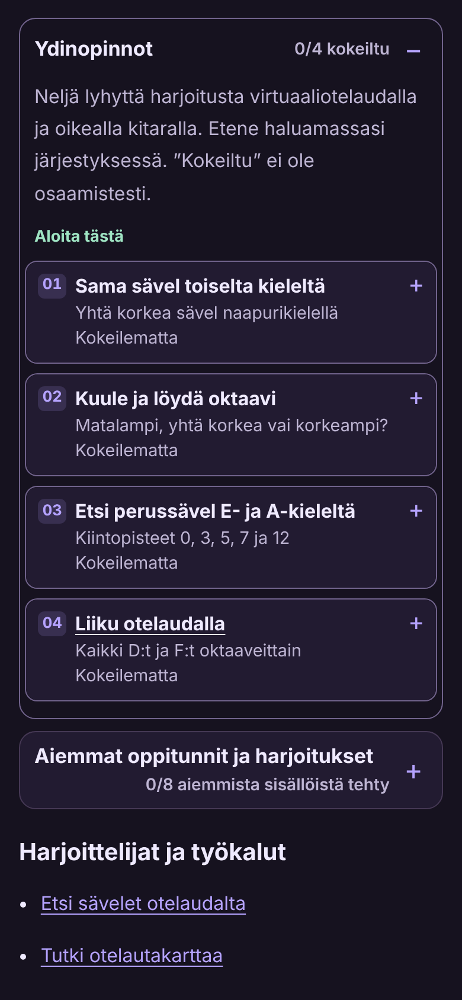
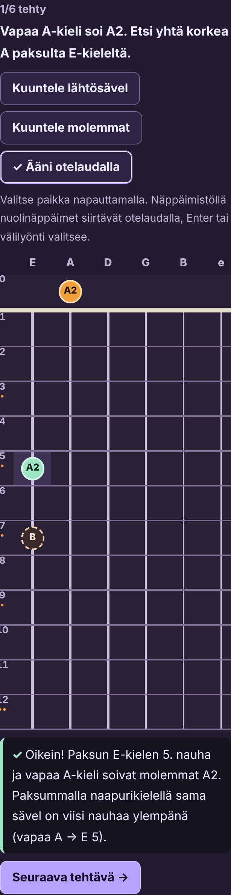
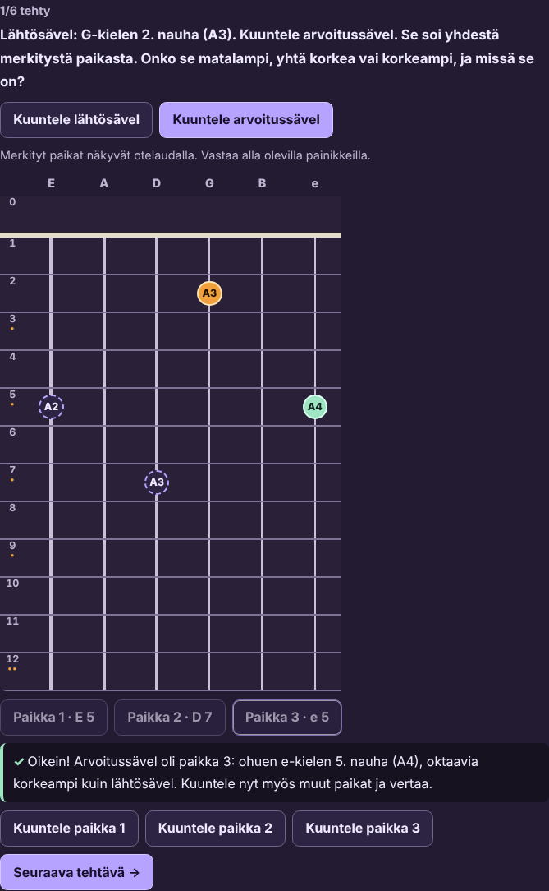

# Otelauta · Ydinopinnot: QA-raportti (#116, vaihe 3)

**23.11.2026 · Draft-PR [#179](https://github.com/ristotoivanen/Musiikin-kartta/pull/179) · haara `claude/116-otelauta-ydinopinnot` · ei yhdistetty betaan.**
Lähtö `beta` @ `454aee5882346c1834a41ee6f786c6195680cb06`. Suunnitelma ja inventaario: [../../oppiminen/otelauta-ydinopinnot-116-2026-11-23.md](../../oppiminen/otelauta-ydinopinnot-116-2026-11-23.md).

## Suunnittelu ja katselmointinäyttö

Ohje: docs/suunnittelu/suunnittelu-ja-pr-katselmointi.md
**Riski:** uusi käyttäjän kulku ja aihesivun rakenne. Ei mikrofonia, ei uusia tallennusavaimia, ei muutoksia yhteiseen äänimoottoriin, Otelautaoppaaseen tai Kitaraharjoittelijaan.
**Oppija ja käyttötilanne:** kitaran perustiedot tunteva oppija puhelimella tai tietokoneella, kitara käden ulottuvilla.
**Mitä tulos ei mittaa:** virtuaalinen oikea vastaus ei todista paikan löytämistä oikealta kitaralta; pitkäaikaista oppimista ei ole tutkittu.

| Kohta | Tila | Näyttö |
|---|---|---|
| UX-1 · reitit, ankkurit, tunnisteet | **Todennettu** | 8 aiempaa osoitetta, `#valinta-…`-ankkurit ja tunnisteet ennallaan (Vitest + Playwright); oman sivun paluu korttiin ja fokus; ”Kokeiltu” (`harjoitus:<uusi>`) ja ”Tehty” (aiemmat) erillään; aiheen ja etusivun laskuri vain aiemmille 8:lle |
| UX-2 · ilman JS:ää | **Todennettu** | Selainkonteksti `javaScriptEnabled: false`: neljä harjoitusta, tekstiversiot ja vastaukset, kitaraosuudet ja 8 vanhaa linkkiä löytyvät; lauta ei näy toimimattomana |
| UX-2 · tulostus | **Ei testattu** | CSS piilottaa sovelluksen tulosteessa; ei tulostuskoetta |
| A11Y-1 · näppäimistö | **Todennettu automaattisesti** | Laudalla yksi sarkainpysähdys, nuolinäppäimet, Enter valitsee; ”Seuraava” siirtää fokuksen tehtävään |
| A11Y-3 · nimet ja tilaviestit | **Osittain** | Solujen saavutettavat nimet (”vapaa A-kieli, lähtösävel A2”), palaute `role="status"`; arvoitussävel ei paljastu nimessä ennen vastausta. **Ruudunlukijan puhe ei testattu** (VoiceOver/NVDA) |
| A11Y-4 · kontrasti, pakotetut värit | **Ei testattu** | Merkit erottuvat myös tekstillä (nimi/numero/?), ei pelkällä värillä; mittausta ei tehty |
| A11Y-5 · 320/360/390 px, 200 % | **Todennettu automaattisesti** | Ei sivun vaakavieritystä; kuusikielinen lauta mahtuu 320 px:iin; 200 % tekstillä lauta vierittyy omassa kehyksessään (perusteltu 2D-poikkeus), muu sivu rivittyy. 400 % selainzoomia vastaa 320 px:n reflow-koe |
| A11Y-6 · kohteet | **Todennettu automaattisesti** | Laudan solut ≥ 24 px leveitä (AA) ja 44 px korkeita; 320 px:ssä noin 38 px leveitä eli alle projektin 44 × 44 px -tavoitteen (tiheä otelauta, kirjattu poikkeus) |
| AUDIO-1 · käynnistys ja lopetus | **Osittain** | Ääni vain painalluksesta; uusi toisto pysäyttää edellisen; piilotus, sivulta poistuminen ja oppitunnin sulkeminen pysäyttävät. Ääni voidaan kytkeä pois. **Fyysinen iPhone/Android ei testattu** |
| AUDIO-2 · sisältö | **Todennettu emuloidusti** | Oskillaattorikutsujen taajuudet: E 7 = 123,47 Hz (B2), E 5 = 110 Hz (A2), G 2 = 220 Hz (A3), e 5 = 440 Hz (A4). **Ei kuunneltu** |
| MIC-1/2, DEVICE-1 | **Ei sovellu / ei testattu** | Ei mikrofonia; fyysistä laitekoetta ei tehty |
| PED-1–5 | **Todennettu (asiantuntija-arvio)** | Sävelet, kielet, nauhat ja oktaavit käsin ja testeillä; palaute erottaa ensimmäisen yrityksen, useamman yrityksen, vihjeen ja näytetyn vastauksen. **Omistajan pedagoginen hyväksyntä ja käyttäjäkoe puuttuvat** |

## Testikomennot ja tulokset

Paikallinen ympäristö: Linux-kontti, Chromium 1243 (`/opt/pw-browsers/chromium`), Node 22.

| Komento | Tulos |
|---|---|
| `python3 tools/oppimiskartta/rakenna.py --tarkista` | OK |
| `python3 tools/oppimiskartta/rakenna-osiot.py --tarkista` | OK |
| `python3 tools/linkit/tarkista-linkit.py` | 121 sivua, 2 980 viittausta, 0 ongelmaa |
| `npm run check` (lint, Vitest, build) | OK; **716/716** Vitest (44 tiedostoa) |
| `npx playwright test tests/e2e/otelauta-ydinopinnot.spec.ts` (desktop + phone) | **32/32** |
| Koko `npx playwright test`, commit `2579c3c` | 1 115 läpi, 49 ohitettu, 6 epäonnistui (ks. alla) |
| Uusinta korjausten jälkeen: `aihesivut`, `aihelista`, `lukumerkinnat`, `otelauta-ydinopinnot` | **198/198** |
| CI `#116 Otelauta Ydinopinnot QA`, [ajo 45204207140](https://github.com/ristotoivanen/Musiikin-kartta/actions/runs/45204207140): WebKit (Safari-työpöytä + iPhone 13 -emulaatio) | **44/44** |
| CI samassa ajossa: static-and-unit | OK |

**Koko regression kuusi epäonnistumista (commit `2579c3c`):**

- 5 × yhteiset testit (`aihesivut.spec.ts`, `aihelista.spec.ts`, `lukumerkinnat.spec.ts`) odottivat kovakoodatusti, että vain Rytmi ja Soinnut käyttävät tekstiä ”x/y aiemmista sisällöistä tehty”. **Tämän muutoksen aiheuttama, korjattu** commitissa `ca06643`: odotus luetaan aiheet.json:n `progress_text`-tiedosta.
- 1 × `responsive.spec.ts` ”pehmeä vieritys … positio 1” (Kitaraharjoittelija). **Lähtötilan epävakaa testi:** sama 2/6 epäonnistumista toistuu muuttamattomassa betassa `454aee5` (`--repeat-each=3`). Ei liity Otelauta-sivuihin.

Paikallisesti WebKitiä ei voitu asentaa (lataus estetty kontin verkkosäännöillä), joten WebKit-näyttö on CI:stä.

## Kuvakaappaukset

| Näkymä | Kuva |
|---|---|
| Aihesivu, Ydinopinnot auki, 390 px |  |
| 01 Sama sävel: väärä ja oikea yritys, 390 px |  |
| 02 Oktaavi vastauksen jälkeen, 1280 px |  |
| 04 Kaikki D:t kesken, 1280 px |  |

## Manuaalisesti testattavaa ennen beta-yhdistämistä

1. **Kuuntelu:** demoäänien sävelkorkeus ja voimakkuus kuulokkeilla ja puhelimen kaiuttimella; erottuuko oktaavi selvästi unisonosta (02).
2. **Fyysinen iPhone/Safari ja Android/Chrome:** ensimmäinen ääni painalluksesta, lukituksen/taustan jälkeen ei ääntä itsestään, oppitunnin sulkeminen pysäyttää.
3. **Ruudunlukija** (VoiceOver iOS, NVDA/Chrome): laudan navigointi, solujen nimet, palaute-ilmoitukset eivät tulvi.
4. **Kontrasti ja pakotetut värit:** merkkien rajat, tilaviestien värit.
5. **Kosketus 320 px:ssä:** noin 38 px leveät solut – osuuko sormi oikeaan nauhaan?
6. **Oikealla kitaralla:** ovatko Kokeile kitaralla -ohjeet selkeitä ja mielekkäitä kohderyhmälle.
7. **Käyttäjäkoe (§7):** 3–5 kohderyhmän oppijaa; tehtävät ”löydä ensimmäinen harjoitus”, ”tee 02 ja selvitä vastaus ilman ääntä”, ”palaa aiempaan harjoitukseen”.

## Katselmointipäätös

**Ehdollinen jatkokatselmointi.** Ei beta- tai tuotantojulkaisupäätös.
