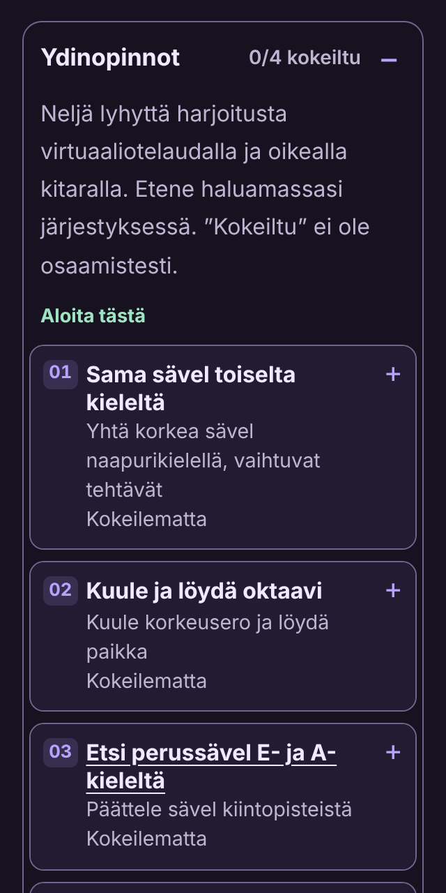
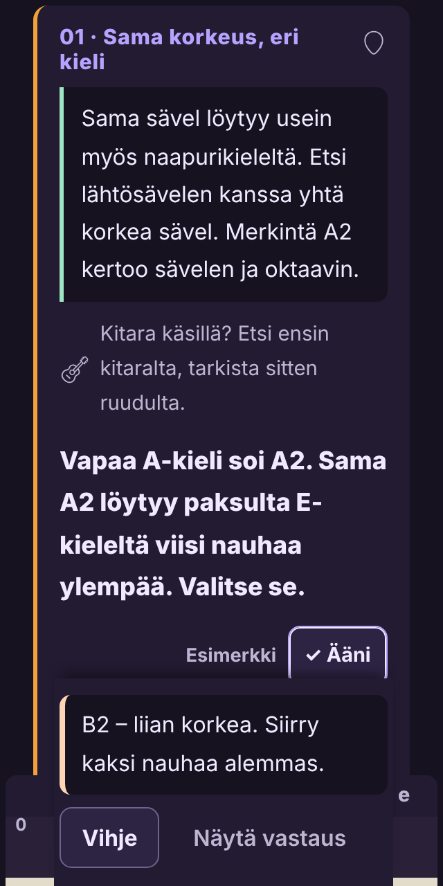
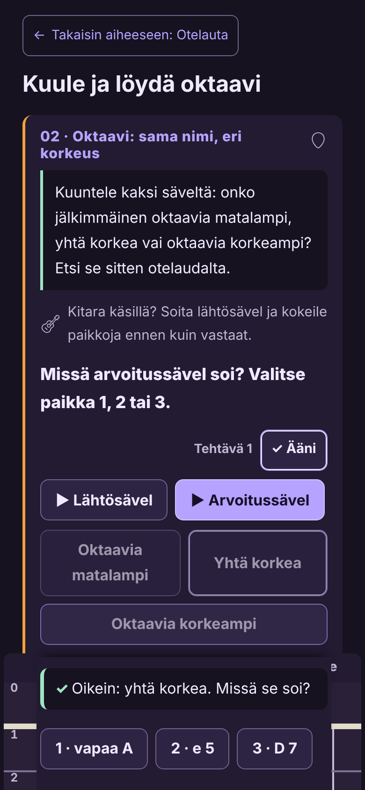
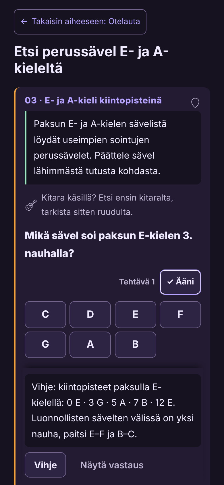
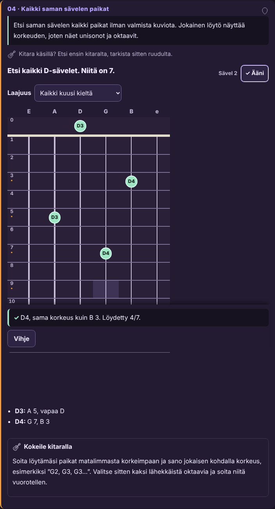

# Otelauta · Ydinopinnot: QA-raportti (#116, vaihe 3 ja 3b)

**23.11.2026 · Draft-PR [#179](https://github.com/ristotoivanen/Musiikin-kartta/pull/179) · haara `claude/116-otelauta-ydinopinnot` · ei yhdistetty betaan.**
Lähtö `beta` @ `454aee5882346c1834a41ee6f786c6195680cb06`. Suunnitelma, inventaario ja auditointihavainnot: [../../oppiminen/otelauta-ydinopinnot-116-2026-11-23.md](../../oppiminen/otelauta-ydinopinnot-116-2026-11-23.md).

Vaihe 3b (tämä päivitys) korvasi kiinteät tehtäväsarjat tehtävägeneraattoreilla, jakoi 02:n kahteen vaiheeseen, lisäsi 04:ään laajuusvalinnan ja levensi mobiililaudan 44 px:n kosketuskohteisiin.

## Suunnittelu ja katselmointinäyttö

Ohje: docs/suunnittelu/suunnittelu-ja-pr-katselmointi.md
**Riski:** uusi käyttäjän kulku, satunnaiset tehtävät ja aihesivun rakenne. Ei mikrofonia, ei uusia tallennusavaimia, ei muutoksia yhteiseen äänimoottoriin, Otelautaoppaaseen tai Kitaraharjoittelijaan.
**Oppija ja käyttötilanne:** 1–2 vuotta soittanut kitaristi puhelimella tai tietokoneella, kitara käden ulottuvilla.
**Mitä tulos ei mittaa:** virtuaalinen oikea vastaus ei todista paikan löytämistä oikealta kitaralta; pitkäaikaista oppimista ei ole tutkittu.

| Kohta | Tila | Näyttö |
|---|---|---|
| UX-1 · reitit, ankkurit, tunnisteet | **Todennettu** | 8 aiempaa osoitetta, `#valinta-…`-ankkurit ja tunnisteet ennallaan (Vitest + Playwright); oman sivun paluu korttiin ja fokus; ”Kokeiltu” (`harjoitus:<uusi>`) ja ”Tehty” (aiemmat) erillään; aiheen ja etusivun laskuri vain aiemmille 8:lle |
| UX-2 · ilman JS:ää | **Todennettu** | `javaScriptEnabled: false`: neljän harjoituksen tekstiversiot ja vastaukset, kitaraosuudet ja 8 vanhaa linkkiä löytyvät. JS:n kanssa tekstiversio piilotetaan |
| UX-2 · tulostus | **Ei testattu** | CSS piilottaa sovelluksen tulosteessa |
| A11Y-1 · näppäimistö | **Todennettu automaattisesti** | Laudalla yksi sarkainpysähdys, nuolet, Home/End, PageUp/PageDown, Enter; ”Uusi tehtävä” siirtää fokuksen tehtävälauseeseen; 04:n laajuus natiivina valintalistana |
| A11Y-2 · fokus ei peity | **Osittain** | Tahmea palautepaneeli; laudan painikkeilla `scroll-margin-block: 4rem 10rem`. Testattu vain automaattisesti, ei ruudunlukijalla |
| A11Y-3 · nimet ja tilaviestit | **Osittain** | Solujen nimet (”vapaa A-kieli, lähtösävel A2”), palaute `role="status"`; 02:n paikkojen nimet ”paikka 1–3” eivät paljasta vastausta. **Ruudunlukijan puhe ei testattu** |
| A11Y-4 · kontrasti, pakotetut värit | **Ei testattu** | Merkit erottuvat tekstillä (A2, 1–3, ?), ei pelkällä värillä |
| A11Y-5 · 320/360/390 px, 200 %, 400 % | **Todennettu automaattisesti** | Ei sivun vaakavieritystä; koko kuusikielinen lauta näkyvissä 320 px:ssä; 200 % tekstikoolla kaikki kielet saavutettavissa; 400 %:n reflow vastaa 320 px:n koetta |
| A11Y-6 · kohteet | **Todennettu automaattisesti** | Kaikki laudan solut ≥ 44 × 44 px 320/360/390 px:ssä (320 px: noin 48 × 44 px) |
| AUDIO-1 · käynnistys ja lopetus | **Osittain** | Ääni vain painalluksesta; uusi toisto pysäyttää edellisen; piilotus, sivulta poistuminen ja oppitunnin sulkeminen pysäyttävät; äänen voi kytkeä pois. **Fyysinen iPhone/Android ei testattu** |
| AUDIO-2 · sisältö | **Todennettu emuloidusti** | Selaintesti lukee soitetut taajuudet ja tunnistaa niistä 02:n arvoitussävelen; arvo on aina lähtösävel ±0/12 puoliaskelta. **Ei kuunneltu** |
| MIC, DEVICE-1 | **Ei sovellu / ei testattu** | Ei mikrofonia; fyysistä laitekoetta ei tehty |
| PED-1–5 | **Todennettu (asiantuntija-arvio + testit)** | Kaikki generaattorien mahdolliset tehtävät tarkistettu; palaute opettaa päättelyä; vihje ja näytetty vastaus näkyvät palautteessa. **Omistajan pedagoginen hyväksyntä ja käyttäjäkoe puuttuvat** |

## Generaattoreiden ja musiikillisen oikeellisuuden testit

`tests/otelauta-ydinopinnot.test.ts` (26 testiä):

- **Kaikki 78 paikkaa:** sävelkorkeus, nimi ja taajuus riippumattomaan laskentaan; E/A-kielen nimet teoriaoppaan taulukkoon.
- **01:** ehdokkaat ovat täsmälleen kaikki naapurikielten yhtä korkeat paikkaparit (82, joista 18 G–B); jokaiselle jokainen 13 nauhasta vastauksena: vain oikea hyväksytään, oktaavi ja suunta nimetään. Generaattori 12 siemenellä × 400: ei saman lähtöpaikan toistoa kolmen sisällä, G–B vähintään joka neljäs, kaikki viisi kieliparia, molemmat suunnat 35–65 %.
- **02:** 35 lähtöpaikkaa; 12 × 500 tehtävää: erot täsmälleen −12/0/+12, kolme eri kieltä, täsmälleen yksi oikea paikka, ei lähtöpaikkaa; vastausnumeroiden jakauma 29–38 %, suhteiden 28–39 %, peräkkäinen sama numero 25–42 %, ei kolmesti samaa suhdetta, kuuden ensimmäisen vastauksen sarja eri jokaisella siemenellä.
- **03:** kaikki 26 E/A-paikkaa ja niiden kiintopisteselitys (etäisyys ≤ 2 nauhaa); 12 × 300 tehtävää: ♯/♭ vasta tehtävästä 5, kaikki 12 sävelnimeä esiintyvät, vähintään seitsemän muuta kuin kiintopistenauhaa.
- **04:** jokainen sävel jokaisella tasolla ratkaistu kokonaan (unisonot, ”valmis”), jokainen vihjetilanne (vihje ei koskaan osoita löydettyä paikkaa), kohdesävel ei toistu kahden sisällä.

## Testikomennot ja tulokset

Paikallinen ympäristö: Linux-kontti, Chromium 1243 (`/opt/pw-browsers/chromium`), Node 22. WebKitiä ei voi asentaa konttiin (lataus estetty verkkosäännöillä); WebKit-näyttö on CI:stä.

| Komento | Tulos |
|---|---|
| `npm run check` (lint, typecheck, Vitest, build) | OK; **720/720** Vitest (44 tiedostoa) |
| `python3 tools/oppimiskartta/rakenna.py --tarkista` ja `rakenna-osiot.py --tarkista` | OK |
| `python3 tools/linkit/tarkista-linkit.py` | 121 sivua, 2 988 viittausta, 0 ongelmaa |
| `npx playwright test tests/e2e/otelauta-ydinopinnot.spec.ts` (desktop + phone) | **40/40**; `--repeat-each=3` satunnaisten tehtävien varalta **120/120** |
| Koko `npx playwright test` (Chromium desktop + phone) | **1 128 läpi, 49 ohitettu, 1 epäonnistui**: `responsive.spec.ts` ”pehmeä vieritys … positio 1” (Kitaraharjoittelija). Sama testi epäonnistuu 2/6 ajossa myös muuttamattomassa betassa `454aee5` (`--repeat-each=3`) → lähtötilan epävakaa testi, ei liity tähän muutokseen |
| CI `#116 Otelauta Ydinopinnot QA` (static, Chromium-regressio, WebKit Safari + iPhone 13 -emulaatio) | Kirjataan PR:ään uusimman commitin ajosta |

## Riippumaton lähtötilan havainto: Riffikaiun aikakatkaisu

PDF-työnkulun `static`-jobi epäonnistui commitissa `6118261`: `tests/riffikaiku-pipeline.test.ts:388` (”mitattu kynnys: soiva kieli pysyy havaittuna pidempään”) ylitti Vitestin oletusrajan 5 000 ms (5 139 ms).

- Paikallisesti testi kestää yksinään **3 207–3 752 ms** sekä tässä haarassa että muuttamattomassa betassa `454aee5` (3 ajoa kummassakin). Koodi on molemmissa sama: tämä PR ei koske Riffikaikuun eikä Vitest-asetuksiin.
- Testi on CPU-sidottu signaalinkäsittelytesti. CI:n rinnakkaisessa ajossa (44 tiedostoa) marginaali loppuu satunnaisesti. Saman commitin oma QA-työnkulku ajoi saman testin onnistuneesti.
- **Johtopäätös:** lähtötilan ajoitusmarginaaliongelma, ei tämän muutoksen aiheuttama. Riffikaiun koodia tai testin aikarajaa ei muutettu. Pysyvä ratkaisu (testin keventäminen tai perusteltu testikohtainen aikaraja) kuuluu Riffikaiun omalle tehtävälle.

## Kuvakaappaukset (vaihe 3b)

| Näkymä | Kuva |
|---|---|
| Aihesivu, Ydinopinnot auki, 320 px |  |
| 01 esimerkki ja suuntapalaute, 320 px |  |
| 02 vaihe B: löydä paikka, 390 px |  |
| 03 vihjeenä kiintopisteet, 390 px |  |
| 04 kaikki kuusi kieltä, kesken, 1280 px |  |

## Fyysisen kitaran koe (ei vielä tehty)

Ehdotettu ennalta sovittava koe 1–2 vuotta soittaneelle, kitara käsissä ja puhelin telineessä. Kirjataan onnistui ilman apua / avustettuna / ei onnistunut, aika ja oppijan oma kokemus.

1. **Unisono:** sovellus antaa viisi 01-tehtävää. Oppija etsii vastauksen ensin kitaralta, soittaa lähtösävelen ja vastauksen peräkkäin ja tarkistaa sitten ruudulta. Tavoite: vähintään neljä viidestä yhtä korkeaksi korvalla ennen tarkistusta, myös vähintään yksi G–B-tehtävä.
2. **Oktaavi korvalla ja kitaralla:** 02:n kuusi tehtävää. Oppija soittaa lähtösävelen kitaralla, vastaa suhteeseen ja soittaa valitsemansa paikan ennen vastaamista. Lisäksi A2, A3 ja A4 hyräillen.
3. **Perussävelet:** soita ilman ruutua G–C–D–Em-kierron matalat perussävelet (E 3, A 3, A 5, vapaa E) ja sitten 03:n kuusi arvottua etsi-tehtävää kitaralta ennen tarkistusta.
4. **Kaikki paikat:** 04, laajuus ”Kaikki kuusi kieltä”: oppija etsii kitaralta kaikki annetun sävelen paikat 90 sekunnissa ja merkitsee ne vasta sitten ruudulle. Kirjataan löydetyt/kaikki ja käytetyt vihjeet.
5. **Kertaus 3–7 päivän päästä** uusilla arvotuilla sävelillä ilman vihjeitä (§7).

## Manuaalisesti testattavaa ennen beta-yhdistämistä

1. **Kuuntelu:** demoäänien korkeus ja voimakkuus kuulokkeilla ja puhelimen kaiuttimella; erottuuko oktaavi unisonosta selvästi (02).
2. **Fyysinen iPhone/Safari ja Android/Chrome:** ensimmäinen ääni painalluksesta, lukituksen jälkeen ei ääntä itsestään, oppitunnin sulkeminen pysäyttää; laudan reunoihin levitys ja tahmea paneeli oikeassa selaimessa.
3. **Ruudunlukija** (VoiceOver iOS, NVDA/Chrome): ruudukon navigointi, paikkojen nimet, tilaviestit, 04:n laajuuslista.
4. **Kontrasti ja pakotetut värit.**
5. **Käyttäjäkoe (§7):** 3–5 kohderyhmän oppijaa, tehtävät ”löydä ensimmäinen harjoitus”, ”tee 02 ilman ääntä”, ”vaihda 04:n laajuutta ja palaa aiempaan harjoitukseen”.

## Katselmointipäätös

**Ehdollinen jatkokatselmointi.** Ei beta- tai tuotantojulkaisupäätös.
