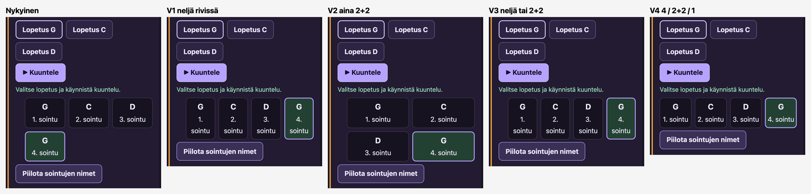
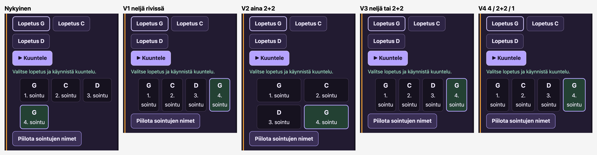
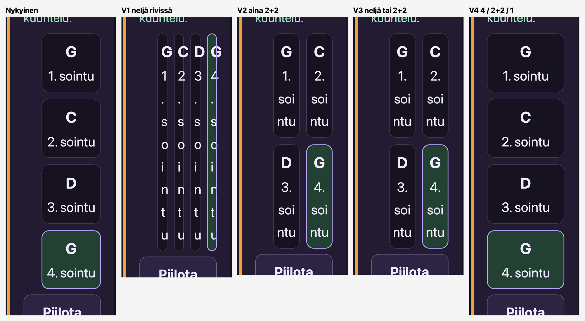
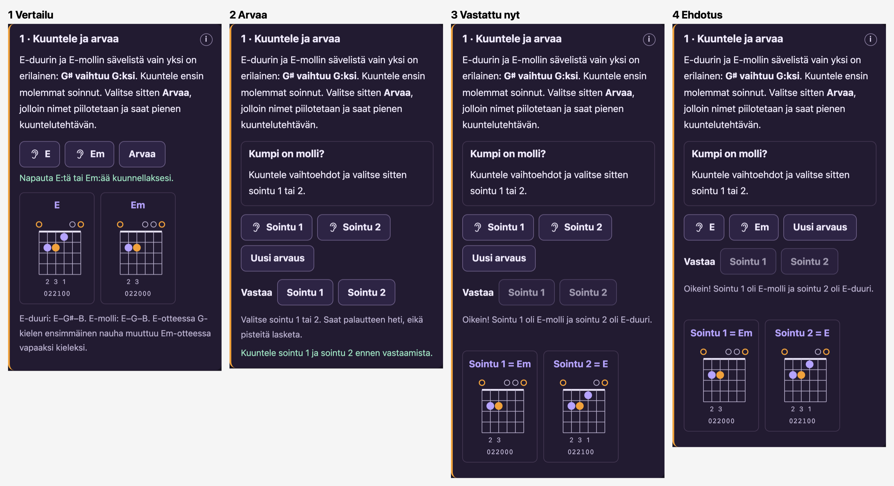

# Soinnut · Ydinopinnot v0.5 · jatkokatselmuksen kierros 20.11.2026

**PR:** #137 (Draft), haara `codex/soinnut-ydinopinnot-v05`. **Lähtö-HEAD:** `f87a619` (ohjeen
`739ea64` + Codexin neljä myöhempää mobiili- ja avauskorjausta). **Pohja:** #133 `25712ed`.
**Tila:** ei beta-mergeä. Tuotekoodiin, sisältöihin ja generoituihin sivuihin ei ole koskettu.
Tällä kierroksella muuttuivat vain tämä kansio ja yksi e2e-testi.

Lähteinä olivat `soinnut_pr137_jatkokatselmointi_2026-11-20.md` (löydösten tunnukset) ja
`ydinopinnot_yhteinen_suunnittelu_ja_QA_tarkistuslista.md`.

## Yhteenveto päätöksiä varten

| ID | Mitä tehtiin | Tulos | Kenen päätös |
|---|---|---|---|
| PED-02 | Kesto ja päällekkäisyys mitattiin renderöidystä äänestä. Lisäksi tehtiin kaksi vaihtoehtoa kuunneltaviksi. | Nykyisessä versiossa kaksi säveltä soi kuuluvasti yhtä aikaa noin 0,45 s ja kaikki kolme 0 s. | Omistaja kuuntelun jälkeen |
| UI-01 | 03:n sointurivistä tehtiin neljä vaihtoehtoa: kuusi leveyttä ja 200 % tekstikoko. | Suositus V4 (4 / 2+2 / 1). Mukana on myös CSS-virheen korjaus. | Omistaja kuvista |
| PED-01 | Tarkka tekstisiirto kirjattiin. | Siirto valmiina, ei toteutettu | Suunnittelukeskustelu |
| PED-05 (uusi) | 03 alkaa valmiiksi valitulla lopetuksella G. | Ristiriidassa tarkistuslistan kanssa | Suunnittelukeskustelu |
| UI-02 | E/Em:n Arvaa-tila testattiin. | Paluuta ei ole. Ehdotus ei lisää uusia painikkeita. | Omistaja |
| A11Y-01 | Näppäimistöllä testattiin. | Nykyinen `aria-disabled` on perusteltu. Muutosta ei ehdoteta. | Varmistetaan ruudunlukijalla |
| T-01 | Tekninen virhe: sointurivin sisennys | `.practice ol` ohittaa `.sointu-kierto { padding: 0 }` | Korjataan UI-01:n kanssa |
| T-02 | ⓘ-regressiotesti oli heikko. | Korjattu: testi kattaa nyt kaikki päätoiminnot. | Tehty |
| INTEG-01 | Koeyhdistys #134:n kanssa ilman haaramuutoksia | 87 ristiriitaa, joista 6 käsin kirjoitetuissa tiedostoissa | Erillinen integraatiotyöpuu |

Fyysisiä laite- ja kuuntelukokeita ei ole tehty. Ne ovat [kuuntelukoelomakkeessa](kuuntelukoelomake.md)
merkinnällä *tekemättä*.

## 1. PED-02 · 01 ”Sävelet yksitellen”: ajoitus mitattuna

Lähde: `assets/sointuharjoitus.js`, `plans.yksitellen = notes(TRIAD, 1.2, 0.48, 0.52)`. Sävelet ovat
G3, B3 ja D4, ja jokaisen verhokäyrä on sama kuin `schedule()`-funktiossa: 14 ms nousu, tasainen osuus
ja 0,22 s eksponentiaalinen häivytys. Ääni mitattiin renderöimällä se `OfflineAudioContext`illa
kanavalta, jolla on oikeat OGG-näytteet. Mittaus käytti 10 ms RMS-kehyksiä. Säveltä pidettiin
kuuluvana, kun se oli enintään 30 dB koko esimerkin huipun alapuolella.
Skripti on [`mittaus/ped02-mittaus.cjs`](mittaus/ped02-mittaus.cjs) ja tulokset ovat
[`mittaus/ped02-mittaus.json`](mittaus/ped02-mittaus.json).

| Versio | Aloitukset (s) | Kesto (s) | Koodin päällekkäisyys | **Mitattu kuuluva päällekkäisyys** G–B / B–D | Kaikki kolme | Kokonaiskesto |
|---|---|---|---|---|---|---|
| **Nykyinen** | 0 · 0,52 · 1,04 | 1,20 | 0,68 s | **0,45 s / 0,47 s** | 0 s (koodissa 0,16 s) | 2,24 s |
| A · erillään | 0 · 0,70 · 1,40 | 0,62 | 0 | 0 / 0 (tauko ~0,29 s) | 0 | 2,02 s |
| B · pilotin tahti | 0 · 1,18 · 2,36 | 1,05 | 0 | 0 / 0 (tauko ~0,36 s) | 0 | 3,41 s |
| (vertailu) Sävelet yhdessä | 0 · 0 · 0 | 1,90 | – | koko ajan | 1,90 s | 1,90 s |

**Havainnot**

- Raportin luku 0,68 s on koodin nimellinen päällekkäisyys. Häivytyksen vuoksi kaksi säveltä kuuluu
  yhtä aikaa noin 0,45 s, ja tasainen yhteinen osuus on 0,46 s. Kaikki kolme eivät soi kuuluvasti
  samaan aikaan: G on jo vaimentunut, kun D alkaa.
- Nykyinen versio on siis legato-murtosointu. Ainoa yksin soiva hetki on B:n noin 0,05 s jakso
  G:n loppumisen (1,00 s) ja D:n alun (1,05 s) välissä.
  Se kuulostaa todennäköisesti luontevalta, mutta erottelee sävelet vähemmän kuin ”yksitellen” lupaa.
- **A** pitää kokonaiskeston ennallaan ja erottaa sävelet. Kitaralla vaimennettu, lyhyt soitto voi
  kuulostaa töksähtävältä.
- **B** on sama tahti kuin G-pilotin ”peräkkäin” (`perakkain: 1,05 s / 1,18 s`). Se on selkein,
  mutta vie 3,4 s ja toistaa pilotin esimerkin lähes sellaisenaan.
- Vaihtoehto ilman ajoitusmuutosta: nimetään painike uudelleen ”Sävelet peräkkäin”, joka on myös
  pilotin termi. Tämä on suunnittelupäätös.

Kuunneltavat versiot (renderöity samoista näytteistä, AAC 128 kbit/s):
[nykyinen](aani/01-nykyinen.m4a) · [A erillään](aani/01-vaihtoehtoA_erillaan.m4a) ·
[B pilotin tahti](aani/01-vaihtoehtoB_pilotin_tahti.m4a) · [vertailu: yhdessä](aani/01-yhdessa_nykyinen.m4a).
**Äänen ajoitusta ei ole muutettu.**

## 2. UI-01 · 03:n neljän soinnun rivi: kuvavertailu

Kuvissa on 03:n oma sivu, sointujen nimet näkyvissä ja neljäs sointu korostettuna. Korostus on
sama `aria-current="step"`-tila, jonka toisto piirtää. Vaihtoehtojen CSS lisättiin vain
kuvausselaimeen, eikä lähdekoodia muutettu. Aihesivun kortissa mittaukset olivat samat ±2 px
([`mittaus/ui01-ui02-mittaukset.json`](mittaus/ui01-ui02-mittaukset.json)).

| Leveys | Nykyinen | V1 neljä rivissä | V2 aina 2+2 | V3 neljä tai 2+2 | **V4 4 / 2+2 / 1** |
|---|---|---|---|---|---|
| 320 px | 2+2 | 4 (52 px) | 2+2 | 2+2 | 2+2 (123 px) |
| 360 px | **3+1** | 4 | 2+2 | 4 | 4 (67 px) |
| 390 px | **3+1** | 4 | 2+2 | 4 | 4 (75 px) |
| 320 px · 200 % | 1+1+1+1 | **4, teksti ylittää 23 px solun** | 2+2, ”soi/ntu” katkeaa | 2+2, katkeaa | 1+1+1+1 (185 px) |
| 390 px · 200 % | 1+1+1+1 | 4 (41 px) | 2+2 | 2+2 | 1+1+1+1 (255 px) |
| 768 px | 4 | 4 | 4 | 4 | 4 |

Kaikissa vaihtoehdoissa lukujärjestys säilyi (vasemmalta oikealle ja ylhäältä alas), eikä sivulle
tullut vaakavieritystä. Korostuksen synkronointi ei riipu asettelusta: `setupProgression()` merkitsee
`li`-elementin DOM-järjestyksen perusteella. Kaikki vaihtoehdot muuttavat vain CSS:ää, ja nykyinen
e2e-testi (kierron neljä sointua seuraavat äänikelloa) jatkaa voimassaoloaan.





Muut kuvat: [320 px](kuvat/03-kierto-320px.png) · [390 px · 200 %](kuvat/03-kierto-390px-200pct.png) ·
[768 px](kuvat/03-kierto-768px.png).

**Suositus katselmoitavaksi: V4.** Neljä sointua on yhdellä rivillä aina, kun se mahtuu. Kapeimmassa
näkymässä tulee hallittu 2+2, ja suurella tekstillä pystylista. Neljäs sointu ei koskaan jää yksin
riville kolmen jälkeen. Pystylista ei ole 3+1-ongelma, koska lukusuunta on yksiselitteinen. V1 karsiutuu
200 %:n tekstikoossa, ja V2/V3 katkaisevat sanan ”sointu” 200 %:ssa.
V4:n CSS (ehdotus, ei toteutettu):

```css
.sointuharjoitus .sointu-kierto { padding: 0; }            /* T-01 */
[data-sointu-ohjaimet]:has(> .sointu-kierto) { container-type: inline-size; }
.sointu-kierto { grid-template-columns: repeat(4, minmax(0, 1fr)); }
.sointu-kierto li { min-width: 0; }
@container (max-width: 17rem)   { .sointu-kierto { grid-template-columns: repeat(2, minmax(0, 1fr)); } }
@container (max-width: 10.5rem) { .sointu-kierto { grid-template-columns: minmax(0, 1fr); } }
```

`:has()` ja container queryt toimivat Safari 16+/Chrome 105+ -selaimissa. Vanhemmassa selaimessa
näkyy neljän sarakkeen rivi. Tämä pitää vielä testata 200 %:n tekstikoossa oikealla iPhonella.

### T-01 · Tekninen virhe: sointurivin tahaton sisennys

`book/reader.css`:n `.practice ol { padding-left: 1.35rem }` (spesifisyys 0,1,1) ohittaa säännön
`.sointu-kierto { padding: 0 }` (0,1,0). Sointurivi on siksi 21,6 px sisennetty (200 %:ssa 43 px),
eikä se ole linjassa painikkeiden kanssa (näkyy kuvissa). Sisennys kaventaa rivin 323 px:stä noin
301 px:iin 390 px:n näkymässä. Korjaus on yksi valitsin, mutta se muuttaa ulkoasua, joten se kuuluu
samaan hyväksyntään UI-01:n kanssa.

## 3. PED-01 · 03:n ”G on kotisointu” -selityksen siirto (ehdotus, ei toteutettu)

Lähde on `tools/oppimiskartta/sisallot/soinnut/mihin-kappale-haluaa-palata.html`. Nyt kohdassa
**2 · Kokeile itse** paljastetaan G:n rooli ennen kuin oppija on itse verrannut lopetuksia.

**Poistetaan kohdasta 2 · Kokeile itse:**

> **Harmoninen suunta.** Tässä G-duuriin rakentuvassa kierrossa G toimii kotisointuna eli toonikana.
> Sen paluu voi tuntua lopetukselta. Kuulokokemus ei silti ole kaikille täysin samanlainen.

**Kohtaan 2 jää:** ”Vertaa ainakin kahta lopetusta. Mikä kuulostaa sinusta päättyneeltä? Mikä jättää
odottamaan jatkoa? Kuuntele ensin, päätä vasta sitten.”

**Mitä opit? (uusi teksti, siirretyt lauseet lihavoituna vain tässä):**

> Harmonia ei ole pelkkää sointujen vaihtumista. Sointujen järjestys ja suhde toisiinsa voivat
> synnyttää odotuksen, jännitteen ja paluun kokemuksia. **Tässä G-duuriin rakentuvassa kierrossa G
> toimii kotisointuna eli toonikana, ja sen paluu voi tuntua lopetukselta. Kuulokokemus ei silti ole
> kaikille täysin samanlainen.**

Uutta väitettä (esim. ”D jättää odottamaan”) tai uutta Paljasta-painiketta ei lisätä. Aihesivun
kortissa ”Mitä opit?” on edelleen samassa kortissa harjoituksen alla. Siirto muuttaa vain
järjestyksen havainnosta selitykseen, joten se ei estä oppijaa lukemasta selitystä etukäteen.
Muutos koskee myös PED-04:ää: kohdassa 2 on tämän jälkeen pelkkä pohdintaohje.

### PED-05 (uusi havainto) · 03 alkaa valmiiksi valitulla G-lopetuksella

`<button data-lopetus="G" aria-pressed="true">`. Ensimmäinen kuuntelu soittaa siis aina G–C–D–**G**,
eli sen lopetuksen, jonka harjoitus haluaa oppijan tunnistavan kodiksi. Tarkistuslistan mukaan
valintatehtävät alkavat ilman valmiiksi valittua oikeaa vastausta. Toisaalta ensimmäinen kuuntelu
tarvitsee jonkin lopetuksen.

Vaihtoehdot suunnittelukeskusteluun:

- (a) Pidetään nykyinen ratkaisu ja perustellaan se esimerkkitilana.
- (b) Aloitetaan lopetuksella D, jolloin ensimmäinen kokemus on avoin lopetus.
- (c) Ei valintaa: Kuuntele soittaa kolme sointua ja ”?”. Tämä muuttaa toimintaa, eikä sitä suositella
  ilman erillistä suunnitelmaa.

## 4. UI-02 · E/Em:n Arvaa-tila: paluu vertailuun

Testattu 390 px:n puhelinemulaatiossa (kuva [kuvat/02-arvaa-tilat.png](kuvat/02-arvaa-tilat.png)).

| Tila | Näkyvät painikkeet |
|---|---|
| 1 Vertailu | E · Em · Arvaa |
| 2 Arvaa | Sointu 1 · Sointu 2 (kuuntelu) · Uusi arvaus · Vastaa: Sointu 1 · Sointu 2 |
| 3 Vastattu | sama kuin 2, vastauspainikkeet `aria-disabled` |

Nimetyt E/Em-painikkeet palaavat vain **sivulatauksella** (todettu). Vastauksen jälkeen kaaviot
näkyvät järjestyksessä ”Sointu 1 = Em / Sointu 2 = E”, mutta nimettyjä soittopainikkeita ei ole.



**Huomaamattomin ehdotus (kuva 4, vain kuvausselaimessa):** kun oppija on vastannut, nimet on jo
paljastettu. Sointu 1/2 -kuuntelurivi vaihtuu silloin takaisin nimettyyn E/Em-riviin samalla
paikalla. Painikkeita ei tule lisää, eikä niiden määrä muutu. ”Uusi arvaus” piilottaa nimet taas.
Kyse on kahden rivin `hidden`-arvon vaihdosta vastauksen käsittelijässä. Vaihtoehto on lisätä
palautteeseen tekstilinkki ”Takaisin vertailuun”, mutta se olisi uusi toiminto.

Sivuhuomio: 390 px:ssä ”Uusi arvaus” rivittyy omalle rivilleen kuuntelupainikkeiden alle (kuva 2).

## 5. A11Y-01 · Vastatut painikkeet

Mitattu: `aria-disabled="true"`, `disabled=false`, `tabIndex=0`. Enter vastatussa painikkeessa ei
muuta palautetta, ja fokus pysyy painikkeessa. Natiivi `disabled` poistaisi fokuksen
painikkeelta, jota käyttäjä juuri painoi (fokus siirtyisi `body`yn). Nykyinen ratkaisu on siksi
näppäimistön kannalta parempi, eikä muutosta ehdoteta. Palaute on `role="status"`. VoiceOverin ja
TalkBackin ilmoitukset on vielä tarkistettava (lomake).

## 6. Jo hyväksyttyjen yhteisten vaatimusten regressio

| Vaatimus | Tulos | Peruste |
|---|---|---|
| Painikkeen koko ja paikka vakaat kuunnellessa | ✅ automaattinen | e2e: kierron Kuuntele/Pysäytä ja Sointu 1 -koko ennen/jälkeen |
| ⓘ päätehtävän jälkeen, avaaminen ei siirrä päätoimintoja | ✅ automaattinen, **testiä vahvistettu** | T-02 alla. 5 leveyttä × 100/200 % × 7 osoitetta |
| Numeroidut vaihtoehdot Sointu 1/2, ei A/B | ✅ | lähde ja e2e |
| Mikrofonittomuus | ✅ | `getUserMedia`/`mediaDevices` ei esiinny Sointujen skripteissä eikä sivuilla |
| Merkintöjen erillisyys, vanhat 18 | ✅ automaattinen | e2e: progress_text, oma tunniste, kokeiltu |
| Vanhat suorat osoitteet ja tunnisteet | ✅ automaattinen | e2e: vanhat osoitteet, Edellinen/Seuraava |
| Vaakavieritys 320–1200 px, 200 % | ✅ automaattinen | e2e |
| Android/iOS fyysinen | ⛔ **tekemättä** | lomake |

### T-02 · ⓘ-testi vahvistettu (ainoa koodimuutos)

`tests/e2e/soinnut-kokonaisuudet.spec.ts`, testi ”…avattu ⓘ ei siirrä päätoimintoja”. Aiempi testi
mittasi vain ensimmäisen painikkeen. 200 %:n kierroksella se mittasi lisäksi lähtöarvon ⓘ jo
avattuna, koska 100 %:n kierros jätti sen auki. Nyt ⓘ suljetaan ensin. Sen jälkeen testi vertaa
kaikkien näkyvien päätoimintojen ja tilarivin vasenta reunaa ja yläreunaa ennen ja jälkeen avaamisen.

## 7. INTEG-01 · Koeyhdistys Rytmin #134:n kanssa (ei haaramuutoksia)

`git merge-tree --write-tree f87a619 origin/claude/rytmi-ydinopinnot-v09 (a962bf6)`. Molemmat
perustuvat samaan `68b8a77`:ään.

- **87 ristiriitaista tiedostoa.** Käsin kirjoitettuja ovat `assets/edistyminen.js`,
  `assets/kokonaisuudet.css` (add/add), `assets/kokonaisuudet.js` (add/add),
  `tools/oppimiskartta/rakenna.py` ja `tests/e2e/aihesivut.spec.ts`. Lisäksi `index.html` ja
  81 generoitua `oppi/**/*.html`-sivua, joissa erot ovat välimuistiversioita ja generaattorin tulosteita.
- Ratkaisujärjestys: käsin tehdään vain lähteet. Sen jälkeen ajetaan `npm run build:oppimiskartta`,
  ja generoidut sivut tuotetaan uudelleen eikä yhdistetä rivi riviltä. Näin kumpikaan PR ei peitä
  toisen lähdemuutoksia.
- Testattava #137 + #133 + #111 + #134 erillisessä integraatiotyöpuussa. **Ei tehty tällä kierroksella.**

## Täsmällinen diffi

```
docs/qa/soinnut-ydinopinnot-v05/jatkokatselmointi-2026-11-20/   (uusi: raportti, lomake, kuvat, äänet, mittausskriptit)
tests/e2e/soinnut-kokonaisuudet.spec.ts                       (T-02, yksi testi)
```

## Testitulokset (tämä kierros, f87a619 + tämä commit)

- `npx playwright test tests/e2e/soinnut-kokonaisuudet.spec.ts`: **67 läpäisty, 1 ohitettu**
  (työpöytään rajattu testi puhelinprojektissa), desktop + phone (Chromium, iPhone 13 -emulaatio).
- `npm run lint`, `npm run typecheck` ja `npm test` (626 yksikkötestiä) läpäisty.
- Koko Playwright-sarjaa ja `npm run check`ia ei ajettu uudelleen, koska tuotekoodi ei muuttunut.
  Viimeisin koko ajo on Codexin [raportissa](../raportti.md).

**Chromiumin puhelinemulaatio ei ole Safari eikä Android, eivätkä OfflineAudioContext-mittaukset ole
kuuntelukokeita.**
