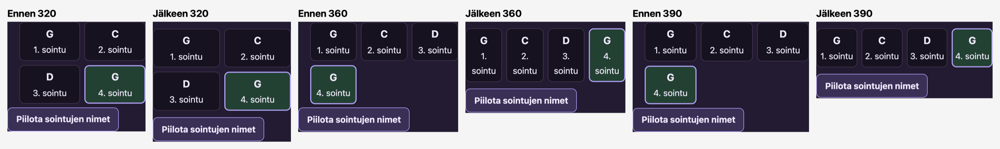
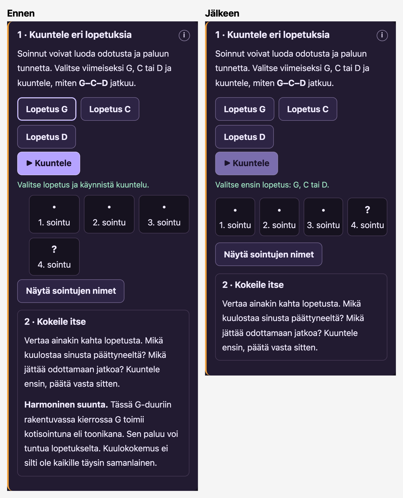
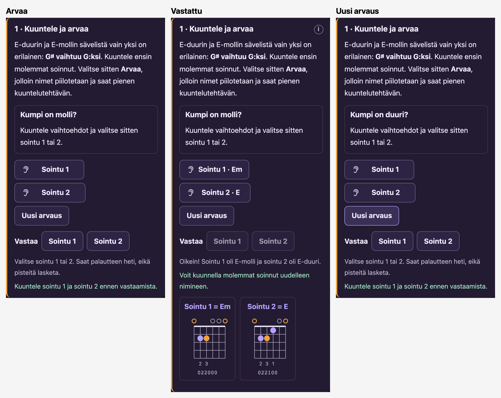
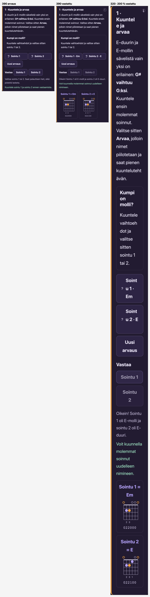

# Soinnut · Ydinopinnot v0.5 · hyväksytyt katselmointikorjaukset 21.11.2026

**PR:** #137 (Draft), haara `codex/soinnut-ydinopinnot-v05`, lähtö `8fa95b5`.
**Pohja:** suunnittelukeskustelussa hyväksytyt kohdat jatkokatselmuksesta
[`../jatkokatselmointi-2026-11-20/raportti.md`](../jatkokatselmointi-2026-11-20/raportti.md).
**Ei beta- eikä tuotantoyhdistämistä.** Integraatio #111:n ja Rytmin #134:n kanssa tehdään myöhemmin
erikseen.

## Toteutettu

### 1 · Harjoitus 03: V4-asettelu ja sisennysvirhe (UI-01, T-01)

- Sointurivi `assets/sointuharjoitus.css`: neljä sointua rinnakkain, kun tila riittää, 2 + 2
  kapealla näytöllä ja yksi riviä kohti suurella tekstillä. Toteutus on container query rivin
  ympärillä olevaan `.sointu-kierto-alue`-elementtiin (`17rem` → 2 + 2, `10.5rem` → 1). Se on
  `@supports (container-type: inline-size)` -lohkon sisällä, joten vanha selain käyttää entistä
  auto-fit-ruudukkoa.
- `.practice ol` -sisennys korjattu: valitsin on nyt `.sointuharjoitus .sointu-kierto` (0,2,0),
  ja se voittaa reader.cssin säännön (0,1,1). Rivi on linjassa painikkeiden kanssa (testattu
  sisennys 0 px).
- DOM-järjestys, `aria-current="step"`-korostus ja äänikellosynkronointi ovat ennallaan. Asettelu
  muuttaa vain CSS:ää, ja kierron synkronointitesti on edelleen voimassa.

| Leveys | Ennen | Jälkeen (aihesivun kortti / oma sivu) |
|---|---|---|
| 320 px | 2 + 2 (sisennetty) | 2 + 2 |
| 360 px | **3 + 1** | 4 |
| 390 px | **3 + 1** | 4 |
| 768 px | 4 | 4 |
| 320/360/390 px · 200 % | 1 + 1 + 1 + 1, sisennetty (mitattu 320 ja 390 px) | 1 + 1 + 1 + 1 |
| 768 px · 200 % | ei mitattu | 2 + 2 / 4 (kortti on kapeampi, oma sivu mahtuu neljään) |


[320 px · 200 %](kuvat/03-rivi-320-200.png)

### 2 · Harjoitus 03: pedagoginen järjestys (PED-01)

”Harmoninen suunta” -kappale poistettiin kohdasta **2 · Kokeile itse**. Sen sisältö on nyt
**Mitä opit?** -osion lopussa: ”Tässä G-duuriin rakentuvassa kierrossa G toimii kotisointuna eli
toonikana, ja sen paluu voi tuntua lopetukselta. Kuulokokemus ei silti ole kaikille täysin
samanlainen.” Kokeilussa ovat nyt vain kuuntelu- ja havainto-ohje. Paljasta-painiketta tai
etenemislukkoa ei lisätty.


[Mitä opit? ennen ja jälkeen](kuvat/03-mita-opit-390.png)

### 3 · Harjoitus 03: aloitustila (PED-05)

- G/C/D ovat kaikki aluksi `aria-pressed="false"`.
- Kuuntele on natiivisti `disabled`, kunnes oppija valitsee lopetuksen. Tilarivi on aluksi
  ”Valitse ensin lopetus: G, C tai D.” ja valinnan jälkeen ”Lopetus C valittu. Kuuntele kierto.”
  (`role="status"`).
- Nimet näkyvissä ja lopetus valitsematta: rivi näyttää G · C · D · ?.
- Painikkeiden koko ei muutu valinnan, toiston, pysäytyksen eikä toiston luonnollisen lopun
  jälkeen (e2e-testit). Valittu lopetus säilyy toiston jälkeen.

[Valittu tila ennen ja jälkeen](kuvat/03-valittu-c-390.png)

### 4 · Harjoitus 02: arvauspelin palaute (UI-02)

- Arvausvaiheessa kuuntelupainikkeet ovat ”Sointu 1” ja ”Sointu 2”.
- Vastauksen jälkeen nimet näkyvät **samoissa painikkeissa** arvotussa järjestyksessä, esim.
  ”Sointu 1 · Em” ja ”Sointu 2 · E”. Saavutettava nimi on ”Kuuntele sointu 1, E-molli”. Molempia
  voi kuunnella uudelleen. Tilarivillä lukee ”Voit kuunnella molemmat soinnut uudelleen nimineen.”
- Uusi arvaus piilottaa nimet ja arpoo uuden järjestyksen ja kysymyksen. Erillistä paluuvalikkoa
  ei ole, eikä nimettyä E/Em-riviä tuoda takaisin.
- Painikkeen leveys on varattu pidemmälle tekstille (`.sointu-varaus`, näkymätön), joten koko ei
  muutu nimien paljastuessa eikä uudessa arvauksessa (mitattu 157 / 160 px kaikissa tiloissa).
- Vastauspainikkeet säilyttävät `aria-disabled`-menettelyn. Fokus pysyy painikkeessa, eikä uusi
  painallus muuta palautetta (e2e).


[Vastattu tila ennen ja jälkeen](kuvat/02-vastattu-390.png)

## Avoin havainto korjauksesta: 02:n kuuntelupainikkeet rivittyvät puhelimessa

Varattu leveys pitää koon vakaana, mutta painikkeet levenevät 120/122 px:stä 157/160 px:iin.
Kahden painikkeen rivi tarvitsee 325 px.

| Leveys | Rivin tila | Ennen | Jälkeen |
|---|---|---|---|
| 320 px | 253 px | rinnakkain | allekkain |
| 360 px | 293 px | rinnakkain | allekkain |
| 390 px | 323 px | rinnakkain | **allekkain, 2 px liian kapea** |
| 768 px | 669 px | rinnakkain | rinnakkain |

Arvausnäkymä on puhelimessa siksi yhden rivin (noin 52 px) pidempi, ja Sointu 1/2 -kuuntelut ovat
allekkain, kun Vastaa-painikkeet ovat rinnakkain. Lisäksi keskitetty teksti jättää korvakuvakkeen
jälkeen näkyvän välin (kuva yllä). Tuotekoodia ei muutettu tämän takia. Vaihtoehdot päätettäviksi:

- (a) Pidetään nykyinen vakaa leveys. Tekstin tasaus vasemmalle (`justify-items: start`) poistaa
  välin kuvakkeen jälkeen. Se on yhden rivin muutos.
- (b) Varausta ei käytetä. Painikkeet pysyvät rinnakkain arvausvaiheessa, mutta Sointu 2 voi
  rivittyä seuraavalle riville nimien paljastuessa (painikkeen koko muuttuu).
- (c) Lyhyempi paljastus, esim. ”1 · Em”. Tämä poikkeaa hyväksytystä esimerkistä
  ”Sointu 1 · Em”.

### Lisäkorjaus (hyväksytty): tasaus vasemmalle ja 4 px:n rako

Omistaja hyväksyi vaihtoehdon (a). Lisäksi kokeiltiin arvauksen kuuntelupainikkeiden välisen raon
pienentämistä. Allekkainen asettelu 320 ja 360 px:n näytöillä hyväksyttiin.

- `.sointu-vaihtuva { justify-items: start; }`: teksti alkaa heti korvakuvakkeen jälkeen
  (väli 7 px, 200 %:ssa 14 px). Varattu tyhjä tila jää painikkeen oikeaan reunaan.
- `.sointu-rivi[data-arvaus-kuuntelu] { column-gap: .25rem; }`: vaakarako 8 px → 4 px (200 %:ssa
  8 px). Pystyrako allekkain pinottuina pysyy 8 px:nä. Muut rivit eivät muutu.
- Nimet, arvottu järjestys, äänet, tekstit ja vastauslogiikka ovat ennallaan.

Mitattu ([`mittaus-02-rako.json`](mittaus-02-rako.json), skripti [`mittaa02b.cjs`](mittaa02b.cjs)):

| Leveys | Oma sivu: tila → tarve 321 px | Aihesivun kortti | 200 % |
|---|---|---|---|
| 320 px | 253 → allekkain | 249 → allekkain | allekkain |
| 360 px | 293 → allekkain | 289 → allekkain | allekkain |
| 375 px | 308 → allekkain | 304 → allekkain | allekkain |
| 390 px | 323 → **rinnakkain (2 px varaa)** | 319 → **allekkain (2 px liian kapea)** | allekkain |
| 768 px | rinnakkain | rinnakkain | oma sivu rinnakkain, kortti allekkain |

- **390 px:** painikkeet mahtuvat rinnakkain harjoituksen omalla sivulla. Aihesivun avatussa
  kortissa sisäreunat ovat 4 px kapeammat, joten siellä ne jäävät allekkain. Mitta on Chromen
  fonttimetriikalla. Safarin tekstinleveys voi poiketa pikselin tai kaksi, joten oikea iPhone voi
  päätyä kumpaan tahansa asetteluun.
- Kaikissa 20 yhdistelmässä (5 leveyttä × 100/200 % × kaksi sivua) painikkeiden koko on sama
  ennen vastausta ja sen jälkeen. Leikkautumista tai vaakavieritystä ei ole.
- 320 px · 200 %: sanat katkeavat kesken (”Soint/u 1 · Em”) koko sivulla, myös otsikoissa ja
  leipätekstissä. Tämä ei ole painikkeiden oma ongelma, eikä tekstiä leikkaudu.



Jos 390 px:n aihesivun kortissakin halutaan rinnakkaiset painikkeet, tarvitaan 2 px lisää tilaa.
Vaihtoehtoja ovat esimerkiksi painikkeiden sivupaddingin pienentäminen 1 px:llä tai kortin
sisäreunan kaventaminen. Tätä ei tehty, koska tehtävä rajattiin raon kokeiluun.

## Täsmällinen diffi

```
assets/sointuharjoitus.css                                   21 ++-  V4, sisennyskorjaus, varattu leveys
assets/sointuharjoitus.js                                    31 ++-  03 aloitustila, 02 nimien paljastus
tools/oppimiskartta/sisallot/soinnut/mihin-kappale-haluaa-palata.html  9 +-  aria-pressed, disabled, teksti, .sointu-kierto-alue
tools/oppimiskartta/sisallot/soinnut/yksi-savel-muuttaa-sointua.html   4 +-  .sointu-vaihtuva-tekstit
oppi/soinnut/*.html (7 sivua)                                generoitu: npm run build:oppimiskartta (sisältö + ?v=)
tests/oppimiskartta-kokonaisuudet.test.ts                    22 +   uusi yksikkötesti
tests/e2e/soinnut-kokonaisuudet.spec.ts                     108 +-  02, 03, luonnollinen loppu, rivitestit, ⓘ 360 px
docs/qa/soinnut-ydinopinnot-v05/korjaukset-2026-11-21/       tämä raportti, kuvat, kuvausskripti
```

Muita aiheita, aiempia 18 sisältöä, niiden osoitteita tai tallennusavaimia ei muutettu.

## Testit (desktop + phone, Chromium)

| Ajo | Tulos |
|---|---|
| `tests/e2e/soinnut-kokonaisuudet.spec.ts` | **89 läpäisty, 1 ohitettu** (työpöytään rajattu testi puhelinprojektissa; lisäkorjauksen jälkeen, mukana 02:n rivitestit 320/360/375/390/768 px) |
| `aihesivut`, `osiot`, `navigation` -e2e | 253 läpäisty, 5 ohitettu (ajettu ennen lisäkorjausta, joka muuttaa vain Sointujen CSS:ää) |
| `npm test` (vitest) | 627 läpäisty (uusi: 03:n aloitustila, tekstin paikka, 02:n varattu tila) |
| `npm run lint`, `npm run typecheck` | läpäisty |

Uudet ja päivitetyt selaintestit kattavat:

- 03:n sointurivin rivityksen, sisennyksen (0 px) ja solujen tekstin ylityksen 320/360/390/768 px
  × 100/200 % sekä aihesivun kortissa että omalla sivulla
- ⓘ:n vaikutuksen kaikkiin päätoimintoihin 320/360/375/390/768/1200 px × 100/200 %
- 03:n aloitustilan, valinnan, koon pysyvyyden ja luonnollisen lopun
- E/Em:n arvonnan, nimien paljastuksen, uudelleenkuuntelun (6 kieltä), saavutettavat nimet,
  fokuksen ja uuden yrityksen

Koko Playwright-sarjaa ei ajettu, koska muutokset rajautuvat Sointujen sivuihin.

Ennen/jälkeen-kuvat otettiin kuvausskriptillä [`ennen-jalkeen.cjs`](ennen-jalkeen.cjs) (390 px,
iPhone 13 -emulaatio). Tilojen mittaukset ovat tiedostoissa [`tilat-ennen.json`](tilat-ennen.json) ja
[`tilat-jalkeen.json`](tilat-jalkeen.json).

## Ei muutettu (odottaa)

- 01:n äänten ajoitus (PED-02) ja 03:n sointujen ääniasettelut (PED-03): odottavat kuuntelukoetta.
- Yhteinen äänimoottori / #132 ja Rytmin #134:n toteutus.
- Integraatio #111:n ja #134:n kanssa (koeyhdistyksessä 87 ristiriitaa, katso jatkokatselmus).

## Tekemättä olevat kokeet

**Fyysisiä iPhone/Safari- ja Android/Chrome-kokeita, VoiceOver-/TalkBack-kokeita ja
kuuntelukokeita ei ole tehty.** Ne ovat lomakkeessa
[`../jatkokatselmointi-2026-11-20/kuuntelukoelomake.md`](../jatkokatselmointi-2026-11-20/kuuntelukoelomake.md).
Tämän kierroksen jälkeen lomakkeeseen kuuluvat lisäksi:

- 03: onko pois käytöstä oleva Kuuntele selvä Safarissa, ja ilmoittaako ruudunlukija tilarivin
  valinnan jälkeen.
- 02: ilmoittaako VoiceOver nimetyt painikkeet (”Kuuntele sointu 1, E-molli”) vastauksen jälkeen.
- Container query -asettelu oikealla iPhonella 200 %:n tekstikoolla.

Chromiumin puhelinemulaatio ei ole Safari eikä Android.
